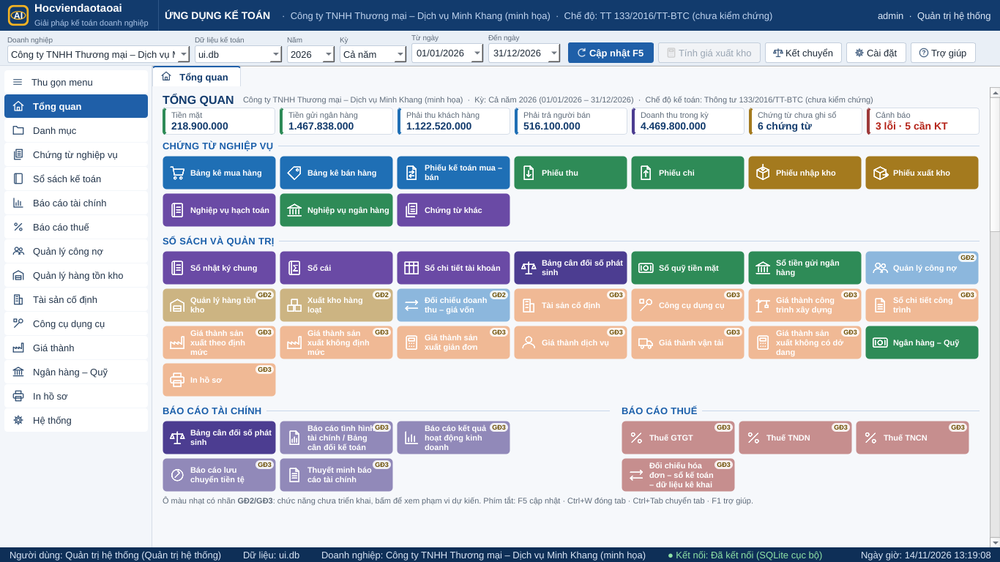

# Ứng dụng Kế toán – Hocviendaotaoai

Phần mềm kế toán Windows (Python + PySide6) cho doanh nghiệp thương mại, dịch vụ, sản xuất, xây dựng, vận tải.
**Bản hiện tại: Giai đoạn 1** – chạy được, có dữ liệu minh họa liên kết đầy đủ.

```
Danh mục → Nhập chứng từ → Kiểm tra → Ghi sổ → (Công nợ, kho, giá thành – GĐ2/3) → Sổ kế toán → Báo cáo
```
Dữ liệu chỉ nhập một lần; mọi dòng sổ mang khóa chứng từ để **truy ngược về chứng từ gốc**.



## 1. Chạy nhanh

```bash
cd ung-dung-ke-toan
python -m pip install -r requirements.txt
python main.py                 # lần đầu tự tạo dữ liệu minh họa
```

| Tài khoản | Mật khẩu | Vai trò |
|---|---|---|
| `admin` | `admin@123` | Quản trị hệ thống (toàn quyền) |
| `ketoantruong` | `ktt@123` | Kế toán trưởng (ghi sổ, khóa kỳ, xuất dữ liệu) |
| `ketoanvien` | `ktv@123` | Kế toán viên (nhập, sửa, xóa – **không** ghi sổ, khóa kỳ) |
| `xem` | `xem@123` | Chỉ xem |

Tùy chọn: `--db <file.db>` mở file chỉ định · `--reset-demo` tạo lại dữ liệu minh họa.
Đóng gói & cài đặt Windows: xem [docs/HUONG_DAN_CAI_DAT.md](docs/HUONG_DAN_CAI_DAT.md).

## 2. Trạng thái chức năng

| Nhóm | Chức năng | Trạng thái |
|---|---|---|
| Giao diện | Header xanh đậm + logo, thanh điều khiển (Doanh nghiệp, Dữ liệu, Năm, Kỳ, Từ/Đến, F5, Tính giá XK, Kết chuyển, Cài đặt, Trợ giúp), menu trái 14 mục thu gọn được, tab làm việc giữ trạng thái, thanh trạng thái 5 mục, ô chức năng nhiều màu theo nhóm nghiệp vụ | ✅ GĐ1 |
| Danh mục | Hệ thống TK, khách hàng, NCC, nhân viên, vật tư hàng hóa, kho, công trình, bộ phận, khoản mục CP, TSCĐ; chặn xóa khi đã phát sinh; **nhập Excel có ánh xạ cột + kiểm tra trước + danh sách lỗi theo dòng** | ✅ GĐ1 |
| Số dư đầu kỳ | Theo TK chi tiết và đối tượng, kiểm tra cân đối | ✅ GĐ1 |
| Chứng từ | 10 loại (Bảng kê mua/bán, PK mua–bán, Phiếu thu/chi, Nhập/Xuất kho, Hạch toán, Ngân hàng, Khác); chỉ hiện cột phù hợp loại; thêm/sao chép dòng; dán nhiều dòng từ Excel; tra cứu nhanh (gõ mã/tên, F3); tự tính thành tiền, thuế; tổng tiền hàng/thuế/thanh toán/Nợ/Có/chênh lệch realtime | ✅ GĐ1 |
| Vòng đời | Nháp → Đã kiểm tra → Đã ghi sổ → Đã khóa kỳ; Bỏ ghi sổ; ghi sổ hàng loạt | ✅ GĐ1 |
| Sổ sách | Nhật ký chung, Sổ cái (kèm tổng hợp đối ứng), Sổ chi tiết TK (lọc đối tượng), Sổ quỹ tiền mặt, Sổ tiền gửi NH, Bảng cân đối số phát sinh (dư lưỡng tính theo đối tượng, kiểm tra cân đối) | ✅ GĐ1 |
| Truy ngược | CĐSPS → Sổ chi tiết → Chứng từ gốc (nhấp đúp/Enter) | ✅ GĐ1 |
| Trung tâm cảnh báo | 3 mức (Lỗi chặn ghi sổ / Cần kiểm tra / Thông tin): lệch Nợ–Có, thiếu TK/đối tượng, nghi trùng hóa đơn, tồn kho âm, công nợ bất thường, chênh lệch tổng hợp–chi tiết, chênh lệch tiền hàng/thuế/tổng, chứng từ thuộc kỳ khóa; mỗi cảnh báo có nguyên nhân, số chênh lệch, chứng từ, nút mở – **không tự sửa** | ✅ GĐ1 |
| Kết chuyển | Xem trước → xác nhận → tạo & ghi sổ; hoàn tác khi kỳ chưa khóa | ✅ GĐ1 |
| Hệ thống | Đa doanh nghiệp, đa năm, khóa kỳ theo tháng, phân quyền 8 quyền × vai trò, nhật ký thay đổi, sao lưu – khôi phục (tự sao lưu an toàn trước khi khôi phục), chế độ kế toán có phiên bản theo ngày hiệu lực | ✅ GĐ1 |
| Xuất | Excel (giữ kiểu số), PDF, xem trước khi in – mọi sổ, danh sách, chứng từ | ✅ GĐ1 |
| GĐ2 | Công nợ chuyên sâu (tuổi nợ, hạn TT), kho nhập–xuất–tồn & số lượng tồn đầu, **tính giá xuất kho**, xuất kho hàng loạt, đối chiếu DT–GV, đọc hóa đơn XML | ⏳ ô hiển thị nhãn **GĐ2**, nút Tính giá xuất kho bị vô hiệu kèm chú thích |
| GĐ3 | TSCĐ (khấu hao), CCDC (phân bổ), giá thành (8 loại), BCTC theo mẫu, hỗ trợ thuế GTGT/TNDN/TNCN, in hồ sơ | ⏳ ô hiển thị nhãn **GĐ3**, mở ra trang mô tả phạm vi – không giả lập |

## 3. Kiến trúc

```
ung-dung-ke-toan/
├── main.py                       # điểm chạy
├── ketoan/
│   ├── domain/                   # KHÔNG phụ thuộc Qt/DB
│   │   ├── money.py              # Decimal, chính sách làm tròn, định dạng VN
│   │   └── constants.py          # trạng thái, quyền, loại chứng từ & cột hiển thị
│   ├── data/                     # truy cập dữ liệu
│   │   ├── schema.sql            # lược đồ SQLite
│   │   ├── db.py                 # kết nối, giao dịch nguyên tử lồng nhau, backup API
│   │   └── seed.py               # tạo CSDL mới + dữ liệu minh họa (qua lớp nghiệp vụ)
│   ├── services/                 # nghiệp vụ
│   │   ├── context.py            # phiên: người dùng, doanh nghiệp, kỳ, kiểm quyền, nhật ký
│   │   ├── auth_service.py       # PBKDF2, vai trò, phân quyền
│   │   ├── catalog_service.py    # danh mục (metadata-driven) + nhập Excel
│   │   ├── voucher_service.py    # lưu / kiểm tra / ghi sổ / bỏ ghi sổ / xóa
│   │   ├── ledger_service.py     # NKC, sổ cái, sổ chi tiết, CĐSPS
│   │   ├── alert_service.py      # trung tâm cảnh báo
│   │   ├── closing_service.py    # kết chuyển cuối kỳ
│   │   ├── period_service.py     # năm tài chính, khóa kỳ
│   │   └── system_service.py     # doanh nghiệp, chế độ KT, số dư đầu, sao lưu, nhật ký
│   ├── reports/export.py         # Excel / PDF / in
│   └── ui/                       # PySide6 – chỉ gọi services, không viết SQL
├── tests/                        # 17 kiểm thử: nghiệp vụ + giao diện offscreen
├── sample_data/ketoan_demo.db    # CSDL mẫu
├── packaging/                    # PyInstaller spec, build_windows.bat, Inno Setup
└── docs/                         # hướng dẫn cài đặt, kết quả kiểm tra, ảnh màn hình
```

**Nguyên tắc dữ liệu**
- Tiền lưu `INTEGER` (đồng), số lượng/đơn giá lưu chuỗi `Decimal` – không dùng float.
- Làm tròn `ROUND_HALF_UP` theo từng dòng: *Thành tiền = round(SL × ĐG)*; *Tiền thuế = round(Thành tiền × TS%)*; tổng chứng từ = tổng các dòng đã làm tròn.
- Bảng `ledger_entry` chỉ được sinh khi **Ghi sổ** và xóa khi **Bỏ ghi sổ**; mọi báo cáo đọc từ bảng này → báo cáo luôn khớp chứng từ đã ghi sổ.
- Mọi thao tác ghi nằm trong `Database.transaction()` (BEGIN IMMEDIATE … COMMIT/ROLLBACK) – lưu đủ hoặc hoàn tác đủ; ghi sổ có chốt chặn cuối kiểm tra tổng Nợ = tổng Có.
- Thuế GTGT trên bảng kê mua/bán được sinh bút toán riêng (Nợ 1331 / Có TK đối ứng; Nợ TK đối ứng / Có 33311).
- **Đa người dùng qua LAN**: không chia sẻ file SQLite qua mạng. Lớp `Database` có giao diện `query/execute/transaction` để thay bằng PostgreSQL (dự kiến cùng GĐ2).

## 4. Chế độ kế toán & quy định

- Chế độ kế toán gắn với **doanh nghiệp + ngày hiệu lực** (bảng `company_regime`, có lịch sử), không mặc định cho mọi doanh nghiệp.
- Danh mục chế độ (TT133/2016, TT200/2014, TT99/2025), mẫu hệ thống TK (theo TT133 cho dữ liệu minh họa) và bảng thuế suất GTGT đều được đánh dấu **CHƯA KIỂM CHỨNG** trên giao diện. Phải đối chiếu văn bản gốc, hiệu lực, phạm vi từ nguồn chính thức trước khi dùng thật.
- Ứng dụng **không tự suy đoán** thuế suất, chỉ tiêu báo cáo hay công thức; kết chuyển không tự tính thuế TNDN.
- Báo cáo thuế (GĐ3) sẽ là **báo cáo hỗ trợ tính toán**, tách biệt với tờ khai điện tử theo cấu trúc của cơ quan tiếp nhận.

## 5. Kiểm thử

```bash
QT_QPA_PLATFORM=offscreen python -m pytest -q tests        # Windows PowerShell: $env:QT_QPA_PLATFORM="offscreen"
```
Kết quả và mô tả các luồng: [docs/KET_QUA_KIEM_TRA.md](docs/KET_QUA_KIEM_TRA.md).
Workflow `.github/workflows/ketoan-windows.yml` chạy kiểm thử trên Linux + Windows, đóng gói `.exe` và kiểm tra exe khởi động.

## 6. Phím tắt chính

`F5` cập nhật · `Ctrl+N` thêm · `F2` sửa · `Ctrl+S` lưu · `Esc` hủy · `F6` kiểm tra · `F9` ghi sổ · `Ctrl+F9` bỏ ghi sổ ·
`Insert` thêm dòng · `Ctrl+D` sao chép dòng · `Ctrl+Delete` xóa dòng · `Ctrl+V` dán từ Excel · `F3` tìm danh mục ·
`Enter` sang ô kế tiếp / mở dòng · `Ctrl+P` in · `Ctrl+W` đóng tab · `Ctrl+Tab` chuyển tab · `Ctrl+B` thu gọn menu ·
`Ctrl+Shift+A` trung tâm cảnh báo · `F1` trợ giúp.
