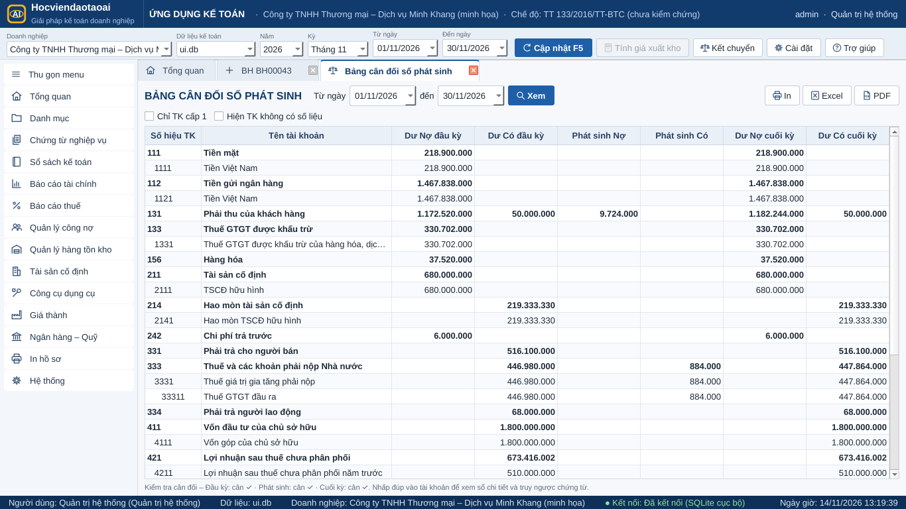
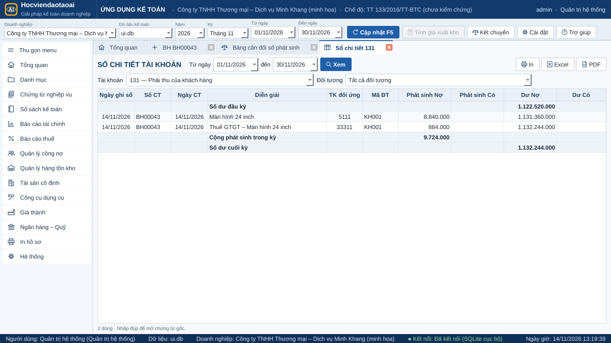
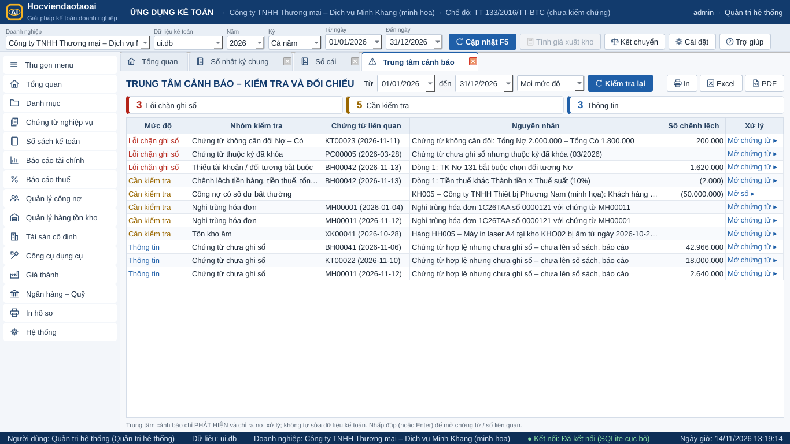
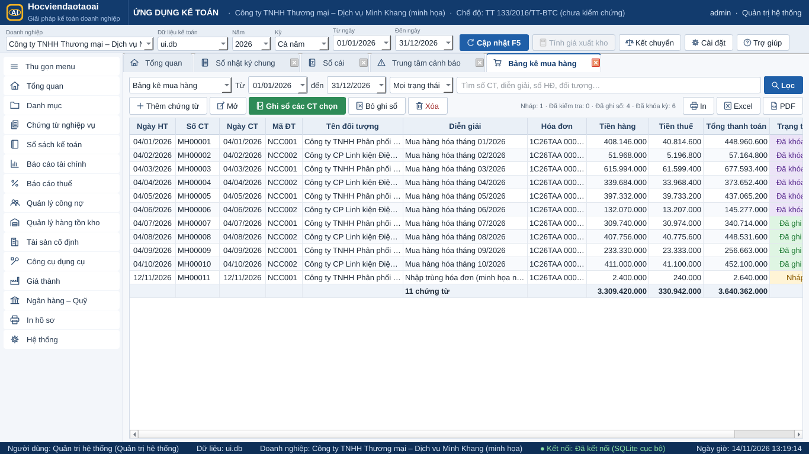
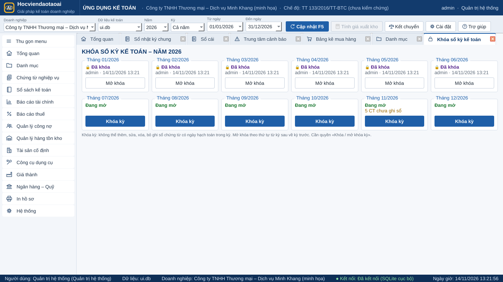
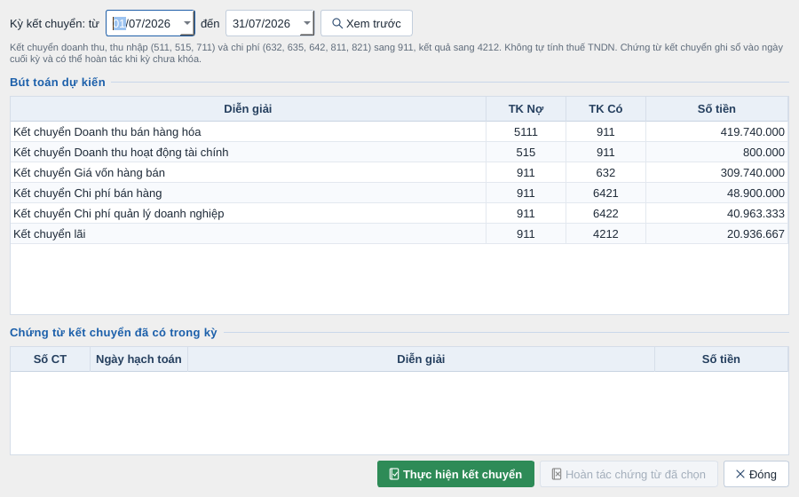
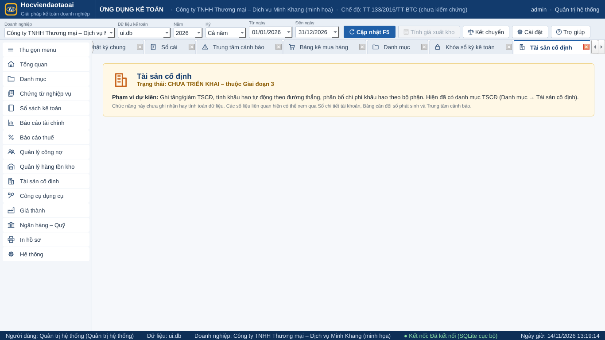

# Kết quả kiểm tra – Giai đoạn 1

Ngày kiểm tra: 14/11/2026 · Python 3.13 · PySide6 6.12 · SQLite · giao diện chạy offscreen ở **1366 × 768**.

```
$ QT_QPA_PLATFORM=offscreen python -m pytest -v tests
17 passed
```

## 1. Dữ liệu minh họa (`sample_data/ketoan_demo.db`)

| Hạng mục | Số liệu |
|---|---|
| Doanh nghiệp | 2 (Thương mại – Dịch vụ Minh Khang; Xây dựng – Vận tải Trường Sơn) – tên, MST đều giả định |
| Hệ thống TK (DN 1) | 123 tài khoản (mẫu TT133 – *chưa kiểm chứng*) |
| Đối tượng | 13 (5 KH, 4 NCC, 4 NV); 7 mặt hàng; 2 kho; 2 công trình; 4 bộ phận; 7 khoản mục CP; 2 TSCĐ |
| Chứng từ | DN 1: 198 đã ghi sổ, 1 đã kiểm tra, 5 nháp · DN 2: 2 đã ghi sổ |
| Bút toán sổ cái | 1.242 dòng |
| Kỳ đã khóa | Tháng 01 – 06/2026 (đã kết chuyển 911 từng tháng) |
| CĐSPS cả năm 2026 | Đầu kỳ 2.788.500.000 = 2.788.500.000 · Phát sinh 26.230.246.662 = 26.230.246.662 · Cuối kỳ 5.636.259.332 = 5.636.259.332 → **cân đối cả 3 cặp cột** |
| Trung tâm cảnh báo | 3 lỗi chặn · 5 cần kiểm tra · 3 thông tin (tình huống cài sẵn để minh họa) |

Dữ liệu được sinh **qua lớp nghiệp vụ** (lưu → kiểm tra → ghi sổ, kết chuyển, khóa kỳ) nên chính quá trình tạo dữ liệu mẫu cũng là
một bài kiểm tra tích hợp với ~200 chứng từ.

## 2. Luồng quan trọng: nhập chứng từ → ghi sổ → lên báo cáo → truy ngược

| Bước | Kiểm thử | Kết quả |
|---|---|---|
| Nhập bảng kê bán hàng (3 × 1.232.000, thuế 10%) | `test_full_flow_voucher_to_reports_and_back` | Tiền hàng 3.696.000 · thuế 369.600 · thanh toán 4.065.600 ✅ |
| Lưu → trạng thái Nháp, **chưa** lên sổ | 〃 | Sổ chi tiết 131 không đổi ✅ |
| Kiểm tra → Đã kiểm tra; Ghi sổ → Đã ghi sổ | 〃 | ✅ |
| Lên Sổ chi tiết 131 đúng 4.065.600, mang `voucher_id` | 〃 | ✅ truy ngược ra đúng số chứng từ |
| Nhật ký chung: đủ 131 / 5111 / 33311, Nợ = Có | 〃 | ✅ |
| CĐSPS cân, phát sinh tăng đúng 4.065.600 | 〃 | ✅ |
| Bỏ ghi sổ → số liệu rút khỏi sổ | 〃 | ✅ |
| Cùng luồng qua **giao diện**: chọn đối tượng, mã hàng, kho, SL, ĐG (định dạng `4.420.000`) → tự tính 8.840.000 + thuế 884.000, gợi ý đối tượng Nợ, tổng "cân đối" → Lưu → Ghi sổ → mở CĐSPS → Sổ chi tiết 131 chứa chứng từ → mở lại đúng tab chứng từ | `test_voucher_entry_post_and_drilldown` | ✅ |

## 3. Kiểm soát & an toàn dữ liệu

| Nội dung | Kiểm thử | Kết quả |
|---|---|---|
| Chính sách tiền: đọc `1.234.567`, `1.234.567,5`, `1,234,567.5`, `12,5`, `(1.000)`; làm tròn nửa lên; định dạng `(1.234.567)` | `test_money_policy` | ✅ |
| Chứng từ lệch Nợ–Có bị chặn ghi sổ, báo đúng chênh lệch 100, **không sinh bút toán** | `test_unbalanced_voucher_is_blocked` | ✅ |
| Hạch toán TK tổng hợp / thiếu đối tượng bắt buộc bị chặn | `test_required_partner_and_parent_account_blocked` | ✅ |
| Kỳ khóa: không lưu mới, không bỏ ghi sổ; mở khóa phải theo thứ tự kỳ sau → trước | `test_locked_period` | ✅ |
| Phân quyền: người xem không lưu được; kế toán viên không ghi sổ / khóa kỳ; sai mật khẩu bị từ chối | `test_permissions` | ✅ |
| Lỗi giữa chừng (mã đối tượng không tồn tại) → **không còn chứng từ dở dang** | `test_transaction_rollback_on_error` | ✅ |
| Trung tâm cảnh báo phát hiện đủ: lệch Nợ–Có, thiếu đối tượng, trùng hóa đơn, tồn âm, công nợ bất thường, lệch thuế, kỳ khóa; mọi cảnh báo có nguyên nhân + đích mở | `test_alert_center_finds_all_demo_cases` | ✅ |
| Kết chuyển: xem trước → thực hiện → 511/911 về 0 → không kết chuyển trùng → hoàn tác khôi phục nguyên trạng | `test_closing_preview_execute_undo` | ✅ |
| Nhập Excel danh mục: thiếu mã, trùng mã trong file → báo đúng dòng, không ghi; xóa danh mục đã phát sinh bị chặn | `test_catalog_import_validation` | ✅ |
| Số dư đầu kỳ thiếu đối tượng bị từ chối; sao lưu → thêm dữ liệu → khôi phục về đúng trạng thái, ghi nhật ký | `test_opening_balance_and_backup_restore` | ✅ |
| Dán 2 dòng từ Excel vào lưới, tổng hiển thị "lệch", ghi sổ bị chặn (vẫn Nháp) | `test_paste_from_excel_and_unbalanced_block` | ✅ |
| Mở **toàn bộ** chức năng trong registry + 14 mục menu không lỗi; chức năng GĐ2/3 mở trang trạng thái | `test_dashboard_and_all_functions_open` | ✅ |
| Hộp thoại kết chuyển có bút toán xem trước; đăng nhập sai/đúng | `test_dialogs_render` | ✅ |
| Xuất Excel giữ kiểu số (tổng PS Nợ = PS Có), xuất PDF hợp lệ | `test_export_excel_pdf` | ✅ |

## 4. Đóng gói
- PyInstaller (`packaging/ketoan.spec`) build thành công; bản đóng gói khởi động, tự tạo CSDL từ `schema.sql` đi kèm, đăng nhập
  và mở cửa sổ chính (kiểm tra trên Linux; trên Windows do workflow `ketoan-windows.yml` thực hiện, gồm bước khởi động exe).

## 5. Ảnh màn hình (1366 × 768)

| | |
|---|---|
|  Tổng quan |  Nhập chứng từ |
|  Đã ghi sổ (chỉ đọc) |  Bảng cân đối số phát sinh |
|  Truy ngược sổ chi tiết |  Trung tâm cảnh báo |
|  Danh sách chứng từ |  Danh mục |
|  Khóa sổ |  Kết chuyển – xem trước |
|  Chức năng chưa triển khai |  Menu thu gọn |

## 6. Giới hạn đã biết (theo phạm vi GĐ1)
- Tồn kho âm được tính theo số lượng phát sinh; **số lượng tồn đầu kỳ** chưa có (GĐ2) – cảnh báo ghi rõ điều này.
- Đơn giá xuất kho nhập tay; tính giá xuất kho tự động thuộc GĐ2 (nút đã vô hiệu kèm chú thích).
- Khấu hao, phân bổ trong dữ liệu mẫu là bút toán nhập tay; tự động hóa thuộc GĐ3.
- Số dư đầu năm sau chưa tự chuyển từ năm trước (chức năng chuyển số dư cuối năm thuộc GĐ3).
- Chưa kiểm thử trên màn hình Windows thật trong phiên này (môi trường Linux offscreen); workflow Windows bổ sung kiểm thử + khởi động exe.
