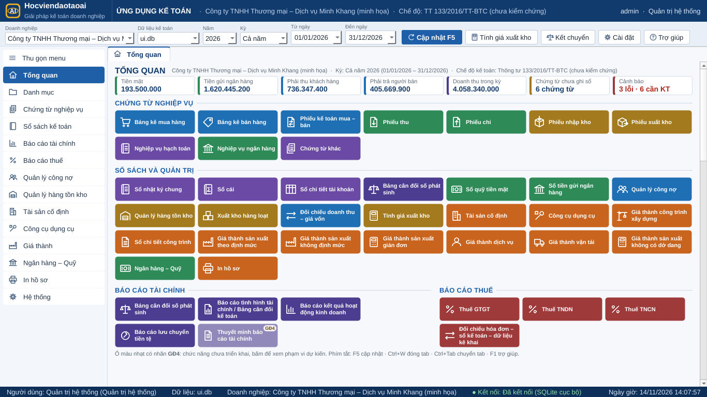

# Hướng dẫn sử dụng – Phần chung (đọc trước)

Tài liệu này áp dụng cho **mọi vai trò**. Sau đó đọc phần dành cho vai trò của mình:

| Vai trò | Tài liệu | Làm gì chính |
|---|---|---|
| Kế toán viên | [01_KE_TOAN_VIEN.md](01_KE_TOAN_VIEN.md) | Nhập danh mục, nhập chứng từ, đọc hóa đơn XML, đối chiếu công nợ/kho, xử lý cảnh báo |
| Kế toán trưởng | [02_KE_TOAN_TRUONG.md](02_KE_TOAN_TRUONG.md) | Kiểm tra, **ghi sổ**, tính giá, khấu hao, kết chuyển, **khóa kỳ**, báo cáo, thuế hỗ trợ, quy trình cuối tháng/năm |
| Quản trị hệ thống | [03_QUAN_TRI_HE_THONG.md](03_QUAN_TRI_HE_THONG.md) | Cài đặt, người dùng & phân quyền, doanh nghiệp, chế độ kế toán, mẫu báo cáo, PostgreSQL, sao lưu |
| Người xem / lãnh đạo | [04_NGUOI_XEM_VA_BAO_CAO.md](04_NGUOI_XEM_VA_BAO_CAO.md) | Xem sổ, báo cáo, truy ngược chứng từ, xuất Excel/PDF |

> **Lưu ý quan trọng về pháp lý.** Chế độ kế toán, hệ thống tài khoản mẫu, thuế suất và mẫu báo cáo đi kèm ứng dụng là **dữ liệu minh họa chưa được kiểm chứng**
> theo văn bản chính thức. Báo cáo thuế chỉ **hỗ trợ tính toán**, không phải tờ khai điện tử. Kế toán trưởng chịu trách nhiệm đối chiếu quy định hiện hành trước khi dùng cho sổ sách thật.

---

## 1. Đăng nhập

1. Mở ứng dụng. Hộp thoại **Đăng nhập** hiện ra; nhập *Tên đăng nhập* và *Mật khẩu*.
2. Lần đầu (hoặc khi dùng mật khẩu mặc định) ứng dụng **bắt buộc đổi mật khẩu**: ≥ 8 ký tự, có cả chữ và số, không trùng tên đăng nhập.
3. Nhập sai mật khẩu **5 lần liên tiếp** thì tài khoản bị **khóa tạm 5 phút**. Báo quản trị viên nếu cần mở sớm.
4. Đổi mật khẩu bất kỳ lúc nào: menu **Hệ thống → Đổi mật khẩu**.

Tài khoản mẫu của dữ liệu minh họa: `admin / admin@123` (Quản trị), `ketoantruong / ktt@123` (Kế toán trưởng), `ketoanvien / ktv@123` (Kế toán viên), `xem / xem@123` (Người xem).
**Không dùng các tài khoản này cho dữ liệu thật.**

## 2. Làm quen với giao diện



| Khu vực | Chức năng |
|---|---|
| **Thanh tiêu đề xanh đậm** (trên cùng) | Logo, tên doanh nghiệp đang mở, chế độ kế toán, người dùng và vai trò |
| **Thanh điều khiển** | *Doanh nghiệp* · *Dữ liệu kế toán* · *Năm* · *Kỳ* · *Từ ngày* · *Đến ngày* · **Cập nhật F5** · **Tính giá xuất kho** · **Kết chuyển** · *Cài đặt* · *Trợ giúp* |
| **Menu trái** (14 mục) | Tổng quan, Danh mục, Chứng từ nghiệp vụ, Sổ sách kế toán, Báo cáo tài chính, Báo cáo thuế, Quản lý công nợ, Quản lý hàng tồn kho, Tài sản cố định, Công cụ dụng cụ, Giá thành, Ngân hàng – Quỹ, In hồ sơ, Hệ thống. Bấm **Thu gọn menu** (hoặc `Ctrl+B`) để có thêm chỗ |
| **Vùng làm việc dạng tab** | Mỗi chức năng mở một tab; chuyển tab không mất bộ lọc hay dữ liệu đang nhập |
| **Ô chức năng màu** (Tổng quan) | Màu theo nhóm nghiệp vụ: xanh lá = tiền; xanh dương = mua–bán, công nợ; vàng nâu = kho; tím = sổ sách, báo cáo; cam = tài sản, giá thành; đỏ trầm = thuế |
| **Thanh trạng thái** (dưới cùng) | Người dùng · Dữ liệu đang mở · Doanh nghiệp · Trạng thái kết nối · Ngày giờ |

### Chọn doanh nghiệp, năm, kỳ
- **Doanh nghiệp**: chọn trong danh sách (ứng dụng quản lý nhiều doanh nghiệp trong cùng dữ liệu).
- **Năm / Kỳ**: chọn *Cả năm*, *Quý 1–4*, *Tháng 01–12* hoặc *Tùy chọn* (tự đặt Từ ngày – Đến ngày).
- Sau khi đổi kỳ bấm **Cập nhật F5** để các tab đang mở lấy số liệu theo kỳ mới.

### Phím tắt
| Phím | Chức năng | Phím | Chức năng |
|---|---|---|---|
| `F5` | Cập nhật theo kỳ đang chọn | `Ctrl+N` | Thêm chứng từ |
| `Ctrl+S` | Lưu | `F2` | Sửa |
| `Esc` | Hủy thay đổi | `F6` | Kiểm tra chứng từ |
| `F9` | Ghi sổ | `Ctrl+F9` | Bỏ ghi sổ |
| `Insert` | Thêm dòng | `Ctrl+D` | Sao chép dòng |
| `Ctrl+Delete` | Xóa dòng | `Ctrl+V` | Dán nhiều dòng từ Excel |
| `F3` | Tìm danh mục cho ô đang chọn | `Enter` | Sang ô kế tiếp / mở dòng đang chọn |
| `Ctrl+P` | Xem trước khi in | `Ctrl+W` | Đóng tab |
| `Ctrl+Tab` | Chuyển tab | `Ctrl+B` | Thu gọn / mở menu trái |
| `Ctrl+Shift+A` | Trung tâm cảnh báo | `F1` | Trợ giúp |

## 3. Nguyên tắc nghiệp vụ cần nhớ

### 3.1. Luồng dữ liệu một chiều
```
Danh mục → Nhập chứng từ → Kiểm tra → Ghi sổ → Sổ sách → Báo cáo
```
- Dữ liệu **chỉ nhập một lần** (ở chứng từ); công nợ, kho, sổ cái, báo cáo đều đọc từ chứng từ **đã ghi sổ**.
- Chứng từ **Nháp / Đã kiểm tra chưa lên sổ** → không xuất hiện trong sổ sách, báo cáo, công nợ, tồn kho.
- Mọi dòng trong sổ/báo cáo đều **truy ngược** được về chứng từ gốc: **nhấp đúp** (hoặc `Enter`) vào dòng.

### 3.2. Bốn trạng thái của chứng từ
| Trạng thái | Ý nghĩa | Được làm gì |
|---|---|---|
| **Nháp** (vàng) | Vừa lưu, có thể còn lỗi | Sửa, xóa, kiểm tra, ghi sổ (nếu hợp lệ) |
| **Đã kiểm tra** (xanh dương) | Không còn lỗi chặn ghi sổ | Sửa (quay về Nháp), ghi sổ, xóa |
| **Đã ghi sổ** (xanh lá) | Đã lên sổ nhật ký chung, sổ cái, công nợ, kho | Chỉ xem; muốn sửa phải **Bỏ ghi sổ** |
| **Đã khóa kỳ** (tím) | Thuộc tháng đã khóa | Không sửa, không bỏ ghi sổ, không xóa; phải **mở khóa kỳ** trước |

### 3.3. Ai được làm gì (phân quyền mặc định)
| Quyền | Quản trị | Kế toán trưởng | Kế toán viên | Người xem |
|---|:-:|:-:|:-:|:-:|
| Xem sổ, báo cáo, chứng từ | ✅ | ✅ | ✅ | ✅ |
| Thêm, sửa, kiểm tra chứng từ & danh mục | ✅ | ✅ | ✅ | – |
| Xóa chứng từ chưa ghi sổ | ✅ | ✅ | ✅ | – |
| **Ghi sổ / Bỏ ghi sổ**, tính giá xuất kho, kết chuyển, hoàn tác | ✅ | ✅ | – | – |
| **Khóa / mở khóa kỳ** | ✅ | ✅ | – | – |
| Xuất Excel, PDF, in | ✅ | ✅ | ✅ | – |
| Quản trị: người dùng, phân quyền, doanh nghiệp, chế độ kế toán, mẫu báo cáo, tham số thuế, sao lưu/khôi phục, chuyển số dư cuối năm | ✅ | – | – | – |

> Quản trị viên có thể thay đổi ma trận này ở **Hệ thống → Người dùng & phân quyền**. Nếu thao tác bị từ chối, ứng dụng nói rõ thiếu quyền nào.

### 3.4. Tiền và làm tròn
- Tiền tính bằng **đồng**, không có số lẻ. Làm tròn **nửa lên theo từng dòng**: *Thành tiền = làm tròn(Số lượng × Đơn giá)*; *Tiền thuế = làm tròn(Thành tiền × Thuế suất)*. Tổng chứng từ = tổng các dòng đã làm tròn.
- Nhập số theo kiểu Việt Nam: `1.234.567` hoặc `1.234.567,5`; số âm hiển thị trong ngoặc `(1.234)`.

## 4. Màn hình Tổng quan và thanh chỉ số

Dải chỉ số trên cùng: Tiền mặt · Tiền gửi ngân hàng · Phải thu khách hàng · Phải trả người bán · Doanh thu trong kỳ · Chứng từ chưa ghi sổ · Cảnh báo. **Bấm vào một chỉ số** để mở sổ/danh sách tương ứng.
Các ô chức năng chưa triển khai (nếu có) hiển thị màu nhạt kèm nhãn giai đoạn.

## 5. Trợ giúp nhanh và hỗ trợ

- `F1` hoặc nút **Trợ giúp**: bảng phím tắt và phạm vi chức năng.
- Mọi lỗi nghiệp vụ hiện bằng hộp thoại tiếng Việt nêu **nguyên nhân** và cách xử lý; dữ liệu **không bị thay đổi** khi thao tác bị từ chối.
- Nếu ứng dụng báo *Lỗi hệ thống*: dữ liệu của thao tác đó đã được hoàn tác nguyên vẹn. Ghi lại nội dung báo lỗi và thời điểm, gửi quản trị viên.
- Câu hỏi thường gặp xem cuối từng tài liệu vai trò.
