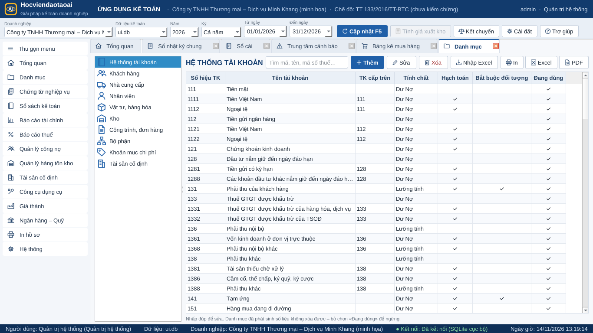
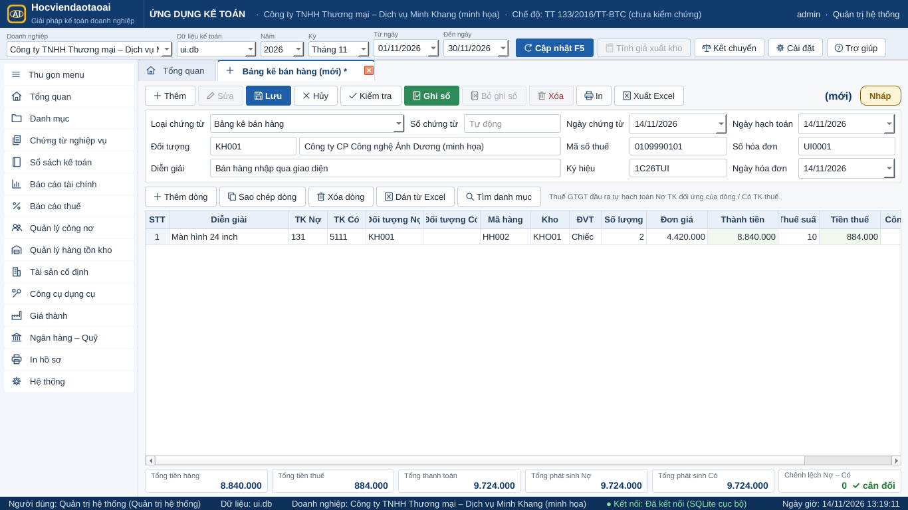
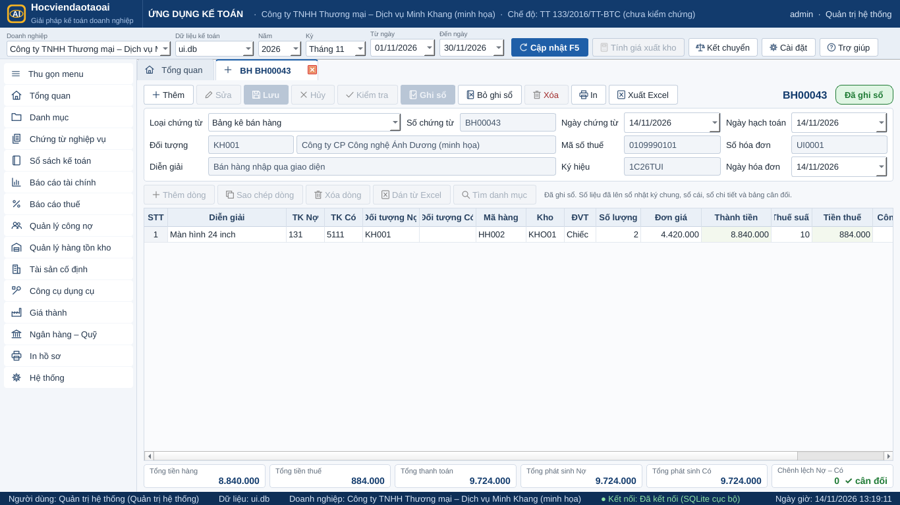
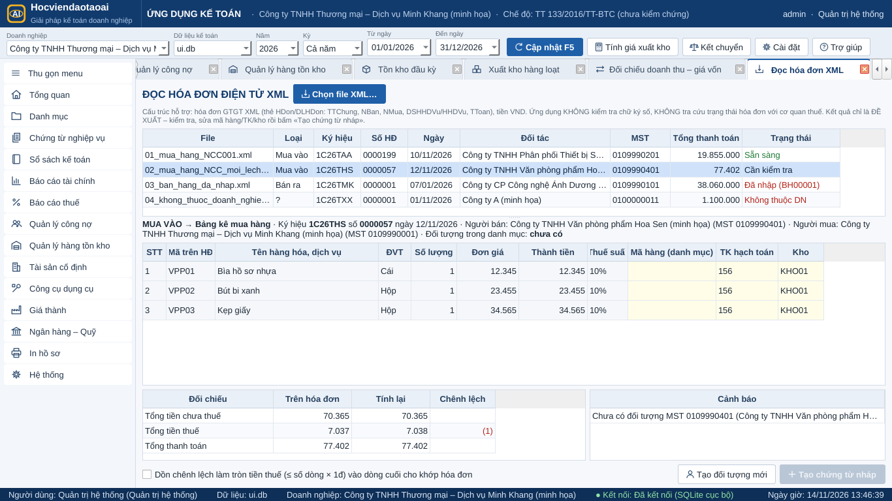
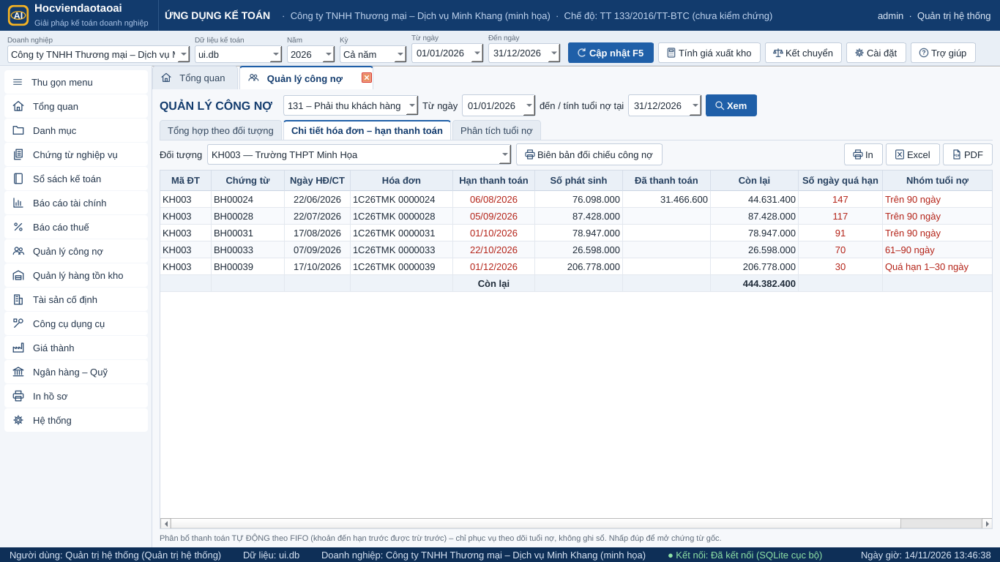
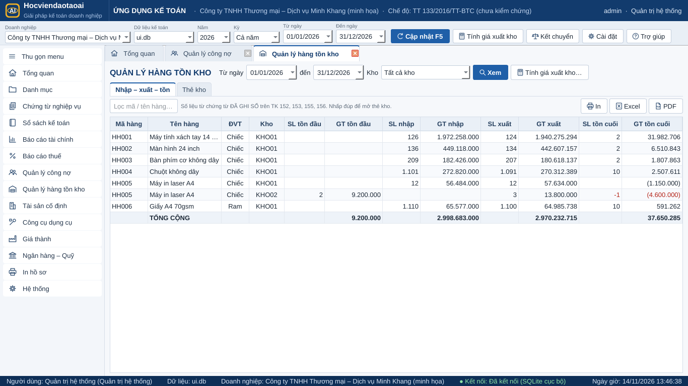
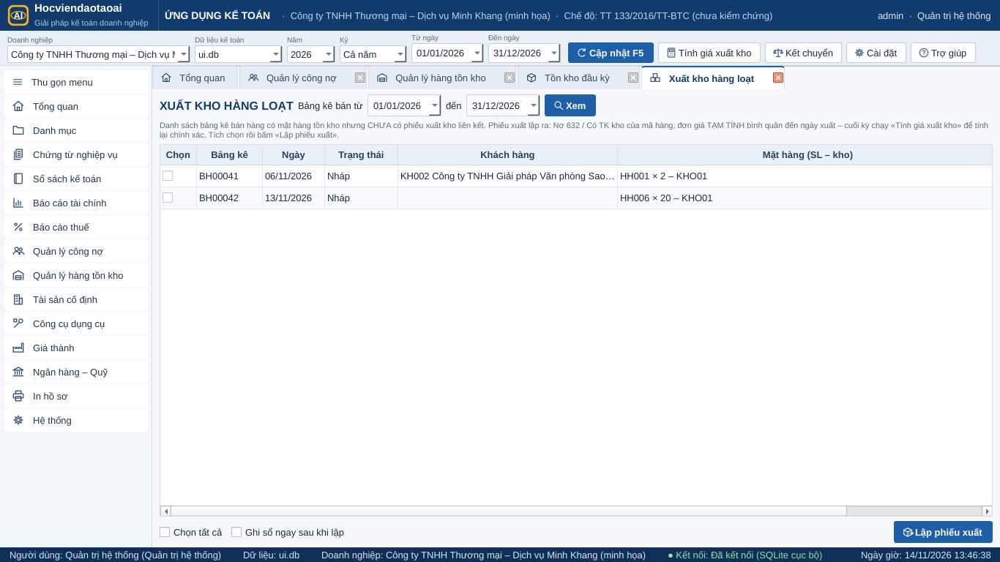
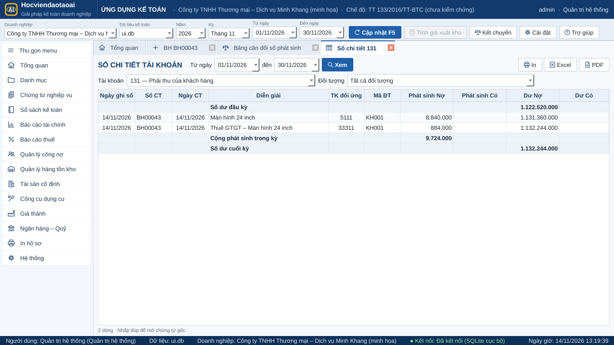
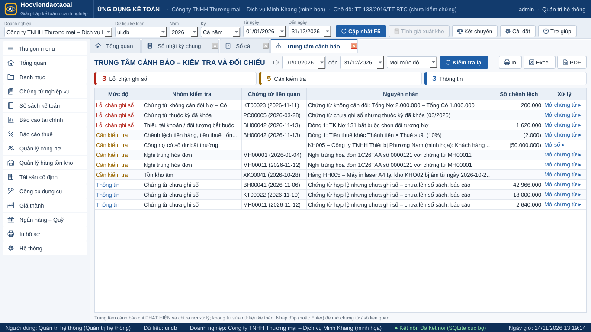

# Hướng dẫn dành cho Kế toán viên

**Bạn làm được:** nhập/sửa danh mục, nhập/sửa/xóa/kiểm tra chứng từ, đọc hóa đơn XML, nhập Excel, lập phiếu xuất kho hàng loạt, xem mọi sổ và báo cáo, xuất Excel/PDF.
**Bạn không làm được:** *Ghi sổ*, *Bỏ ghi sổ*, tính giá xuất kho, kết chuyển, khóa kỳ (việc của Kế toán trưởng).
Quy trình chuẩn: **bạn nhập → Lưu → Kiểm tra (F6) đến khi không còn lỗi → báo Kế toán trưởng ghi sổ.**

Đọc trước [phần chung](00_BAT_DAU_VA_NGUYEN_TAC_CHUNG.md).

---

## 1. Việc làm một lần khi bắt đầu: danh mục và số dư đầu kỳ

### 1.1. Quản lý danh mục
Menu **Danh mục → Danh mục**. Cột trái chọn loại: *Hệ thống tài khoản, Khách hàng, Nhà cung cấp, Nhân viên, Vật tư hàng hóa, Kho, Công trình – đơn hàng, Bộ phận, Khoản mục chi phí, Tài sản cố định*.

| Thao tác | Cách làm |
|---|---|
| Thêm | **Thêm** → điền các ô có dấu `*` → **Lưu** |
| Sửa | Nhấp đúp dòng (hoặc chọn dòng → **Sửa**) |
| Tìm | Gõ vào ô *Tìm mã, tên, mã số thuế…* |
| Ngừng dùng | Sửa → bỏ chọn **Đang dùng** (không xóa được danh mục đã phát sinh) |
| Xóa | Chỉ xóa được danh mục **chưa dùng ở đâu** |

Lưu ý khi tạo danh mục:
- **Khách hàng/Nhà cung cấp:** nhập *Mã số thuế* và *Hạn thanh toán (ngày)* – hạn này tự gợi ý cho hạn thanh toán trên hóa đơn.
- **Tài khoản bắt buộc đối tượng** (131, 331, 141…) – chứng từ phải chọn đối tượng, nếu thiếu sẽ bị chặn ghi sổ.
- **Vật tư hàng hóa:** chọn *Loại* (hàng hóa, vật tư, thành phẩm, CCDC, dịch vụ), *TK kho* và *Thuế suất* mặc định (chỉ để gợi ý, bạn vẫn chọn thuế suất trên từng dòng chứng từ).
- **Tài khoản chi tiết mới:** nhập *Số hiệu* bắt đầu bằng số hiệu TK cấp trên; chỉ TK **chi tiết** (không có TK con) mới hạch toán được.

### 1.2. Nhập danh mục từ Excel
1. Trong danh mục cần nhập → **Nhập Excel**.
2. **Chọn file Excel…** → chọn *Sheet* và *Dòng tiêu đề*.
3. Bảng **Ánh xạ cột**: với mỗi trường (có dấu `*` là bắt buộc), chọn cột Excel tương ứng. Ứng dụng tự gợi ý theo tên tiêu đề.
4. Bấm **Kiểm tra** → xem *Kết quả kiểm tra*. Mọi lỗi được liệt kê **theo từng dòng Excel** (thiếu mã, trùng mã trong file, TK cha không tồn tại…). **Khi còn lỗi, không có dữ liệu nào được ghi.**
5. Hết lỗi → **Nhập dữ liệu**. Mã đã có sẽ được **cập nhật**, mã mới được thêm.

### 1.3. Số dư đầu kỳ
**Danh mục → Số dư đầu kỳ** (số dư đầu *năm tài chính* đang chọn).
- **Thêm dòng** → nhập *Số hiệu TK chi tiết*, *Mã đối tượng* (với TK công nợ), *Dư Nợ* hoặc *Dư Có* (chỉ một bên) → **Lưu**.
- Dòng cuối hiển thị tổng và **Cân đối ✓** / **Lệch …**. Nên lưu khi đã cân.
- **Tồn kho đầu kỳ** (số lượng + giá trị theo hàng và kho): **Danh mục → Tồn kho đầu kỳ**; bảng đối chiếu bên dưới phải **khớp** số dư đầu năm của TK kho 152/153/155/156.

---

## 2. Nhập chứng từ

### 2.1. Mở màn hình nhập
- **Chứng từ nghiệp vụ** (menu trái hoặc Tổng quan) → bấm ô loại chứng từ → màn hình **danh sách** → **Thêm chứng từ** (hoặc `Ctrl+N`).

| Ô chức năng | Dùng khi | Gợi ý hạch toán mặc định |
|---|---|---|
| **Bảng kê mua hàng** | Mua hàng có hóa đơn | Nợ 156 / Có 331; thuế GTGT đầu vào Nợ 1331 |
| **Bảng kê bán hàng** | Bán hàng, cung cấp dịch vụ | Nợ 131 / Có 5111; thuế GTGT đầu ra Có 33311 |
| **Phiếu kế toán mua – bán** | Điều chỉnh mua/bán (giảm giá, trả lại…) | Tự nhập TK |
| **Phiếu thu** | Thu tiền mặt | Nợ 1111 / Có 131 |
| **Phiếu chi** | Chi tiền mặt | Nợ 331 / Có 1111 |
| **Nghiệp vụ ngân hàng** | Thu/chi qua tài khoản ngân hàng | Nợ 1121 / Có 131 |
| **Phiếu nhập kho / Phiếu xuất kho** | Nhập/xuất hàng tồn kho | Nợ 155 / Có 154 · Nợ 632 / Có 156 |
| **Nghiệp vụ hạch toán** | Bút toán tổng hợp (lương, khấu hao, điều chỉnh…) | Tự nhập TK |
| **Chứng từ khác** | Các nghiệp vụ còn lại | Tự nhập TK |

### 2.2. Phần thông tin chung

| Ô | Cách điền |
|---|---|
| **Loại chứng từ** | Đã chọn theo ô bạn mở; chỉ đổi được khi chứng từ chưa lưu |
| **Số chứng từ** | Để trống → tự cấp số kế tiếp (ví dụ `BH00043`) |
| **Ngày chứng từ / Ngày hạch toán** | Ngày hạch toán quyết định chứng từ thuộc **kỳ/tháng** nào; mặc định bằng ngày chứng từ |
| **Đối tượng** | Gõ mã hoặc tên, chọn từ gợi ý (hoặc `F3` để tìm); *Tên* và *Mã số thuế* tự điền |
| **Diễn giải** | Nội dung chung; tự điền vào dòng mới |
| **Ký hiệu / Số HĐ, Ngày hóa đơn** | Có ở bảng kê mua/bán, phiếu mua–bán. Ứng dụng cảnh báo **nghi trùng hóa đơn** |
| **Hạn thanh toán** | Tự gợi ý = ngày hóa đơn + số ngày hạn thanh toán của đối tượng; sửa được. Dùng cho **tuổi nợ** |

### 2.3. Lưới hạch toán
Chỉ hiện các **cột phù hợp loại chứng từ**: STT · Diễn giải · TK Nợ · TK Có · Đối tượng Nợ · Đối tượng Có · Mã hàng · Kho · ĐVT · Số lượng · Đơn giá · Thành tiền · Thuế suất · Tiền thuế · Công trình · Bộ phận · Khoản mục CP.

- **Đi lại:** `Enter` sang ô kế tiếp; hết dòng tự thêm dòng mới.
- **Tra cứu nhanh:** ở ô danh mục (TK, đối tượng, mã hàng, kho…) gõ một phần mã/tên rồi chọn; `F3` mở bảng tìm đầy đủ. Ô **đỏ nhạt** = mã không có trong danh mục.
- **Tự tính:** nhập *Số lượng* và *Đơn giá* → *Thành tiền* tự tính (ô xanh nhạt); nhập *Thuế suất* → *Tiền thuế* tự tính. Muốn nhập tay tiền thuế (ví dụ để khớp hóa đơn), gõ trực tiếp vào ô *Tiền thuế*.
- **Thêm dòng** (`Insert`), **Sao chép dòng** (`Ctrl+D`), **Xóa dòng** (`Ctrl+Delete`).
- **Dán nhiều dòng từ Excel:** chép vùng ô trong Excel → chọn ô đầu muốn dán → `Ctrl+V` (hoặc nút **Dán từ Excel**). Dữ liệu dán vào theo thứ tự các cột hiển thị; số dạng `1.500.000` được đọc đúng.
- **Thuế suất** do bạn chọn theo hóa đơn: ứng dụng **không tự đoán** thuế suất.

### 2.4. Dải tổng tiền (phía dưới)
*Tổng tiền hàng · Tổng tiền thuế · Tổng thanh toán · Tổng phát sinh Nợ · Tổng phát sinh Có · Chênh lệch Nợ – Có.*
Chênh lệch phải bằng **0 – ✓ cân đối** mới ghi sổ được; nếu lệch sẽ hiện **✗ lệch** màu đỏ.

### 2.5. Lưu và kiểm tra

| Nút | Phím | Việc làm |
|---|---|---|
| **Lưu** | `Ctrl+S` | Lưu chứng từ ở trạng thái **Nháp**. Cần ít nhất một dòng hạch toán; lỗi còn lại chỉ chặn ghi sổ, không chặn lưu |
| **Kiểm tra** | `F6` | Kiểm tra đầy đủ; đạt thì chuyển **Đã kiểm tra** |
| **Hủy** | `Esc` | Bỏ các thay đổi chưa lưu |
| **Sửa** | `F2` | Mở khóa để sửa chứng từ chưa ghi sổ |
| **Xóa** | – | Xóa chứng từ chưa ghi sổ (ghi nhật ký) |
| **In / Xuất Excel** | `Ctrl+P` | Xem trước khi in, hoặc xuất chứng từ ra Excel |

Nút **Ghi sổ** và **Bỏ ghi sổ** bị mờ với vai trò của bạn – chuyển cho Kế toán trưởng.

### 2.6. Ví dụ từng bước: bảng kê bán hàng (có thuế 10%)
1. **Chứng từ nghiệp vụ → Bảng kê bán hàng → Thêm chứng từ**.
2. *Đối tượng*: gõ `KH001` → chọn. *Diễn giải*: `Bán màn hình cho KH001`. *Số HĐ*: `0000150`, *Ký hiệu*: `1C26TMK`.
3. Dòng 1: *Mã hàng* `HH002`, *Kho* `KHO01`, *Số lượng* `2`, *Đơn giá* `4.420.000`, *Thuế suất* `10`.
4. Kiểm tra dải tổng: *Tiền hàng* 8.840.000 · *Thuế* 884.000 · *Thanh toán* 9.724.000 · *Chênh lệch* **0 ✓**.
5. `Ctrl+S` → trạng thái **Nháp**. `F6` → **Đã kiểm tra**. Báo Kế toán trưởng ghi sổ.
6. Sau khi ghi sổ, chứng từ chỉ đọc (nhãn **Đã ghi sổ**). Số liệu lên sổ nhật ký chung, sổ cái, công nợ 131 và báo cáo thuế.

### 2.7. Khi Kiểm tra báo lỗi
Hộp thoại liệt kê **Mức độ / Dòng / Nội dung / Chênh lệch**. Sửa theo bảng:

| Thông báo | Cách xử lý |
|---|---|
| *Chứng từ không cân đối: Tổng Nợ … – Tổng Có …* | Thiếu hoặc sai một dòng; xem *Chênh lệch* ở dải tổng |
| *TK … bắt buộc chọn đối tượng* | Điền *Đối tượng Nợ/Có* của dòng đó |
| *TK … là TK tổng hợp* | Chọn TK chi tiết (TK con) |
| *TK … không có trong hệ thống tài khoản* | Sửa số hiệu hoặc nhờ thêm TK trong danh mục |
| *Tiền thuế khác Thành tiền × Thuế suất* | Nhập lại *Thuế suất* hoặc kiểm tra tiền thuế nhập tay có đúng hóa đơn |
| *Nghi trùng hóa đơn … với chứng từ …* | Mở chứng từ kia; nếu trùng thật thì xóa một chứng từ |
| *Ngày hạch toán … thuộc kỳ đã khóa* | Chọn ngày hạch toán trong kỳ còn mở, hoặc nhờ Kế toán trưởng mở khóa |
| *Thiếu mã hàng / Thiếu kho* (mức *Cần kiểm tra*) | Điền để nhập–xuất–tồn đúng |

Mức **Lỗi chặn ghi sổ** bắt buộc phải sửa; mức **Cần kiểm tra** và **Thông tin** không chặn nhưng nên xem.

### 2.8. Danh sách chứng từ
Mở ô loại chứng từ để vào danh sách. Lọc theo *Loại, Từ – đến ngày, Trạng thái, Tìm*. Nhấp đúp để mở. Cột *Trạng thái* có màu theo bốn trạng thái; hàng cuối là **Tổng cộng**. Xuất Excel/PDF bằng nút **Excel / PDF / In** ở góc phải.

---

## 3. Đọc hóa đơn điện tử XML (nhập nhanh hóa đơn mua/bán)

Menu **Chứng từ nghiệp vụ → Đọc hóa đơn XML**.

1. **Chọn file XML…** (chọn được nhiều file một lần).
2. Danh sách hiện *Loại* (Mua vào / Bán ra – tự nhận theo mã số thuế doanh nghiệp), *Ký hiệu, Số HĐ, Ngày, Đối tác, MST, Tổng thanh toán* và **Trạng thái**:

   | Trạng thái | Ý nghĩa |
   |---|---|
   | **Sẵn sàng** | Khớp đối tượng và số liệu – tạo chứng từ được |
   | **Cần kiểm tra** | Chưa có đối tượng trong danh mục, hoặc tổng tiền/thuế lệch |
   | **Đã nhập (số CT)** | Hóa đơn này đã có chứng từ – không tạo trùng |
   | **Không thuộc DN** | MST người bán/mua đều khác MST doanh nghiệp đang mở |

3. Chọn một hóa đơn: xem bảng dòng hàng và các bảng *Đối chiếu* (tổng tiền, thuế, thanh toán trên XML so với tính lại) cùng *Cảnh báo*.
4. Sửa các **ô vàng**: *Mã hàng (danh mục)*, *TK hạch toán*, *Kho* (ứng dụng đã đề xuất; bạn xác nhận hoặc sửa).
5. Nhà cung cấp/khách hàng chưa có: bấm **Tạo đối tượng mới** (lấy tên, MST, địa chỉ trên hóa đơn).
6. Lệch làm tròn thuế vài đồng: tích **Dồn chênh lệch làm tròn tiền thuế…** để khớp tổng thuế trên hóa đơn.
7. **Tạo chứng từ nháp** → chứng từ mở ra để bạn rà soát, *Lưu*, *Kiểm tra* như bình thường.

> Giới hạn: chỉ đọc cấu trúc hóa đơn GTGT dạng XML được hỗ trợ, tiền **VND**; **không kiểm tra chữ ký số** và **không tra cứu trạng thái hóa đơn** trên hệ thống của cơ quan thuế. File có khai báo DOCTYPE/ENTITY bị từ chối vì lý do an toàn.

---

## 4. Công nợ

Menu **Quản lý công nợ → Quản lý công nợ**. Chọn *131 – Phải thu khách hàng* hoặc *331 – Phải trả người bán*, chọn kỳ rồi **Xem**.

| Tab | Nội dung |
|---|---|
| **Tổng hợp theo đối tượng** | Dư đầu kỳ, phát sinh, dư cuối kỳ, **mã số thuế**, số **quá hạn** (đỏ). Nhấp đúp một đối tượng để xem chi tiết |
| **Chi tiết hóa đơn – hạn thanh toán** | Từng hóa đơn: số phát sinh, **đã thanh toán**, **còn lại**, hạn thanh toán, số ngày quá hạn |
| **Phân tích tuổi nợ** | 5 nhóm: Trong hạn · Quá hạn 1–30 · 31–60 · 61–90 · Trên 90 ngày; cột *Ứng trước / trả thừa* |

- Ở tab chi tiết, nút **Biên bản đối chiếu công nợ** in biên bản gửi đối tượng xác nhận (có chữ ký hai bên).
- Tiền thanh toán được **phân bổ tự động theo thứ tự hóa đơn đến hạn trước** – chỉ để theo dõi tuổi nợ, **không ghi vào sổ**.
- Số dư công nợ trên màn hình này **luôn khớp** sổ chi tiết tài khoản 131/331.
- Công nợ có số dư bất thường (khách trả trước, nhà cung cấp dư Nợ) hiện trong **Trung tâm cảnh báo**.

## 5. Kho

Menu **Quản lý hàng tồn kho**:

| Chức năng | Cách dùng |
|---|---|
| **Quản lý hàng tồn kho → Nhập – xuất – tồn** | Chọn kỳ, kho; lọc theo mã/tên hàng; nhấp đúp một dòng để xem **Thẻ kho**. Số âm tô đỏ |
| **Thẻ kho** | Từng lần nhập/xuất của một mặt hàng trong một kho, kèm tồn lũy kế; nhấp đúp mở chứng từ |
| **Tồn kho đầu kỳ** | Nhập số lượng + giá trị đầu năm (xem 1.3) |
| **Xuất kho hàng loạt** | Lập phiếu xuất cho nhiều bảng kê bán cùng lúc (xem dưới) |
| **Đối chiếu doanh thu – giá vốn** | Mỗi mặt hàng: số lượng bán, doanh thu, số lượng xuất, giá vốn, **lãi gộp**, tỷ suất; cột *Cảnh báo* nếu bán chưa xuất kho |

### Xuất kho hàng loạt
1. **Xuất kho hàng loạt** → chọn kỳ → **Xem**: danh sách bảng kê bán hàng **chưa có phiếu xuất**.
2. Tích chọn (hoặc **Chọn tất cả**) → **Lập phiếu xuất**.
3. Phiếu xuất sinh ra hạch toán **Nợ 632 / Có TK kho**, đơn giá **tạm tính** = bình quân đến ngày xuất. Cuối tháng Kế toán trưởng chạy **Tính giá xuất kho** để tính lại chính xác.
4. Mỗi bảng kê chỉ lập **một lần**. Phiếu xuất liên kết với bảng kê nguồn.

## 6. Tài sản cố định, công cụ dụng cụ, chi phí trả trước

- **TSCĐ:** *Danh mục → Tài sản cố định* (hoặc nút **Mở danh mục TSCĐ** ở màn hình *Tài sản cố định*): nhập *Mã, tên, TK nguyên giá, TK khấu hao, TK chi phí, Nguyên giá, Ngày tính KH, Số tháng KH, Bộ phận*, và **Đã khấu hao đầu kỳ** nếu tài sản có từ trước.
- **CCDC & chi phí trả trước:** *Công cụ dụng cụ → Thêm*: khai báo *TK nguồn* (153, 242…), *TK chi phí phân bổ*, *Tổng giá trị*, *Bắt đầu*, *Số tháng*. Việc **ghi tăng** thực hiện bằng chứng từ mua (Nợ 153/242).
- **Chạy khấu hao và phân bổ hàng tháng** do Kế toán trưởng thực hiện (xem tài liệu của Kế toán trưởng). Bạn xem được kết quả ở tab *Danh sách* (nguyên giá, hao mòn lũy kế, giá trị còn lại).

## 7. Xem sổ và truy ngược chứng từ

**Sổ sách kế toán:** *Sổ nhật ký chung, Sổ cái, Sổ chi tiết tài khoản, Bảng cân đối số phát sinh, Sổ quỹ tiền mặt, Sổ tiền gửi ngân hàng.*

- Chọn *Từ ngày – Đến ngày*, tài khoản (và *Đối tượng* ở sổ chi tiết) → **Xem**.
- **Nhấp đúp bất kỳ dòng nào** → mở chứng từ gốc. Ở **Bảng cân đối số phát sinh**, nhấp đúp một tài khoản → mở **Sổ chi tiết** của nó.
- Chỉ chứng từ **Đã ghi sổ** mới có trong sổ. Chứng từ của bạn chưa thấy trong sổ thường là do chưa được Kế toán trưởng ghi sổ.

## 8. Trung tâm cảnh báo (`Ctrl+Shift+A`)
Phát hiện sai sót; **không tự sửa dữ liệu**. Ba mức: **Lỗi chặn ghi sổ** (đỏ) · **Cần kiểm tra** (vàng nâu) · **Thông tin** (xanh).

Mỗi cảnh báo có *Nhóm kiểm tra, Chứng từ liên quan, Nguyên nhân, Số chênh lệch*. Nhấp đúp (hoặc `Enter`) để **mở chứng từ/sổ cần xử lý**. Nên mở trung tâm này trước khi báo Kế toán trưởng ghi sổ cuối tháng.
Các nhóm: chứng từ lệch Nợ–Có · thiếu TK/đối tượng · nghi trùng hóa đơn · tồn kho âm · tồn quỹ âm · công nợ bất thường · chênh lệch sổ tổng hợp–chi tiết · chênh lệch tiền hàng/thuế/thanh toán · chứng từ thuộc kỳ đã khóa · bán hàng chưa xuất kho · tồn đầu kỳ lệch số dư.

---

## 9. Câu hỏi thường gặp

**Em nhập xong nhưng không thấy số liệu trong sổ?** Chứng từ phải **Đã ghi sổ**. Kiểm tra cột *Trạng thái* trong danh sách; nếu *Nháp/Đã kiểm tra* thì chuyển Kế toán trưởng.

**Nút Ghi sổ bị mờ?** Vai trò Kế toán viên không có quyền ghi sổ. Đây là đúng thiết kế (tách người nhập – người duyệt).

**Em lưu nhầm số tiền, chứng từ đã ghi sổ?** Nhờ Kế toán trưởng **Bỏ ghi sổ** (nếu kỳ chưa khóa), bạn sửa rồi kiểm tra lại. Nếu kỳ đã khóa, cần Kế toán trưởng mở khóa kỳ.

**Báo "Số chứng từ … đã tồn tại"?** Bạn đã gõ tay một số trùng. Xóa ô *Số chứng từ* để ứng dụng tự cấp số.

**Báo "Chứng từ đã được … sửa… hãy tải lại"?** (khi nhiều người dùng chung) Người khác vừa sửa chứng từ này. Đóng tab, mở lại để xem bản mới nhất rồi nhập lại thay đổi của mình.

**Dán từ Excel bị lệch cột?** Chọn ô đầu tiên đúng cột cần dán trước khi `Ctrl+V`; thứ tự cột Excel phải trùng thứ tự cột đang hiển thị trên lưới.

**Tìm một chứng từ cũ?** Danh sách chứng từ → ô *Tìm* (số CT, diễn giải, số hóa đơn, tên đối tượng) và chọn khoảng ngày.

**Tạo nhầm chứng từ muốn bỏ?** Chưa ghi sổ: **Xóa**. Đã ghi sổ: nhờ Kế toán trưởng *Bỏ ghi sổ* rồi xóa. Mọi xóa/sửa đều được ghi **Nhật ký thay đổi**.
