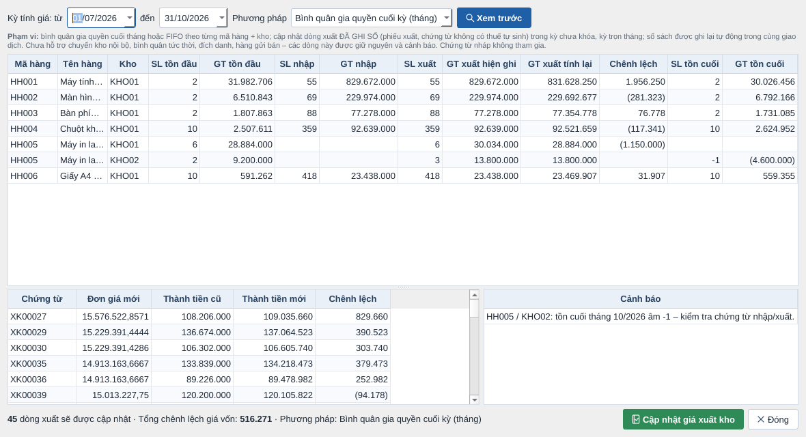
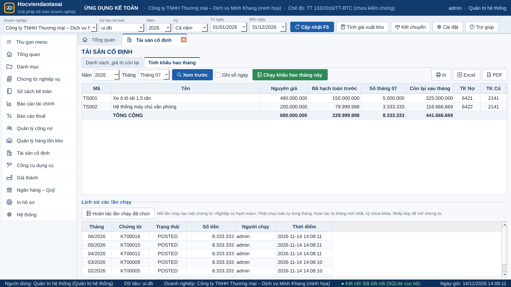
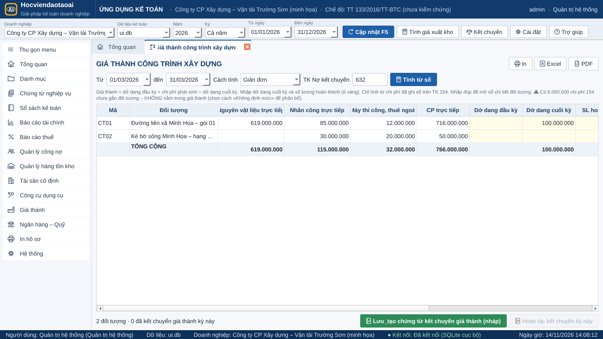
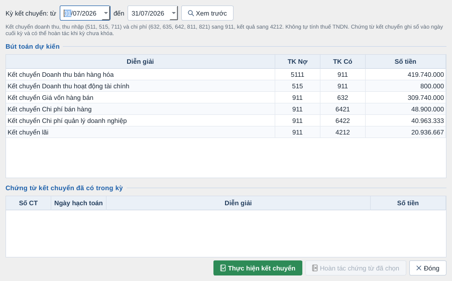
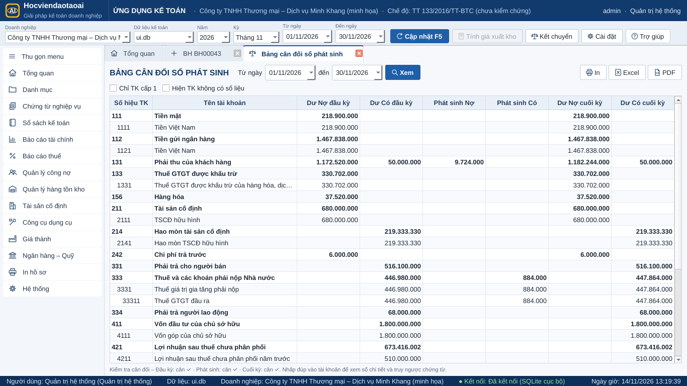
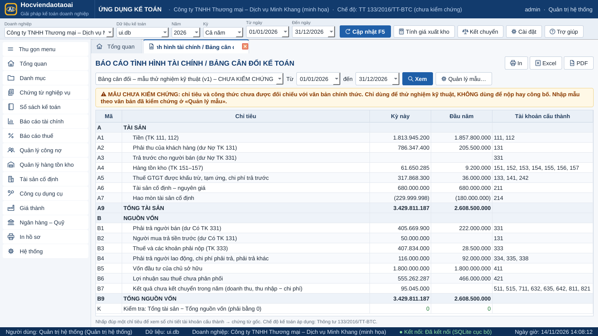
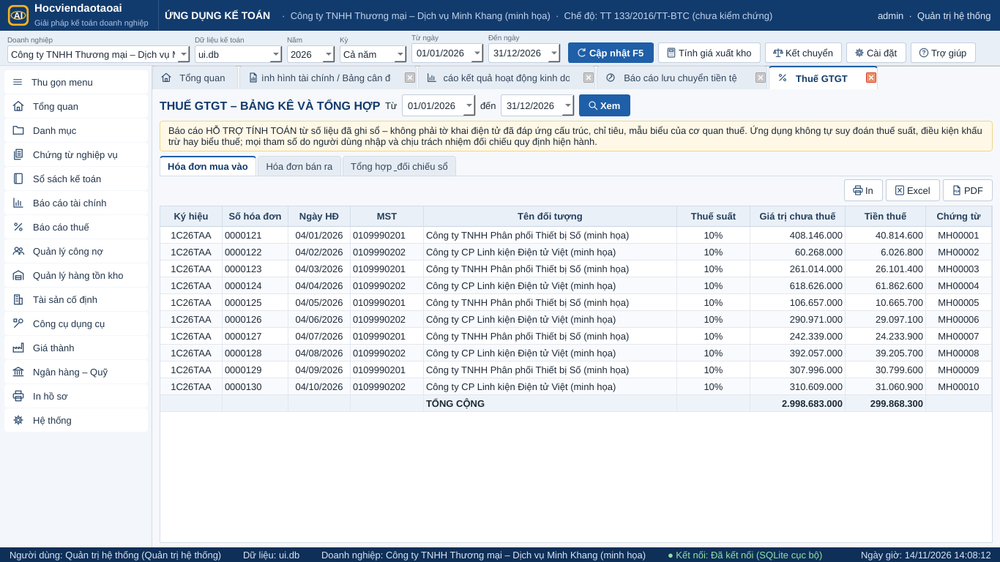
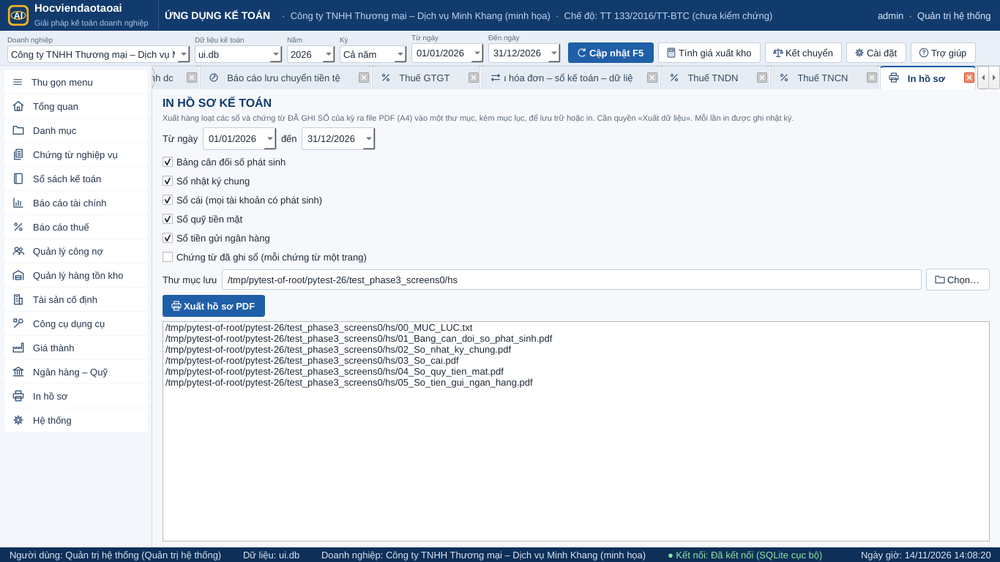
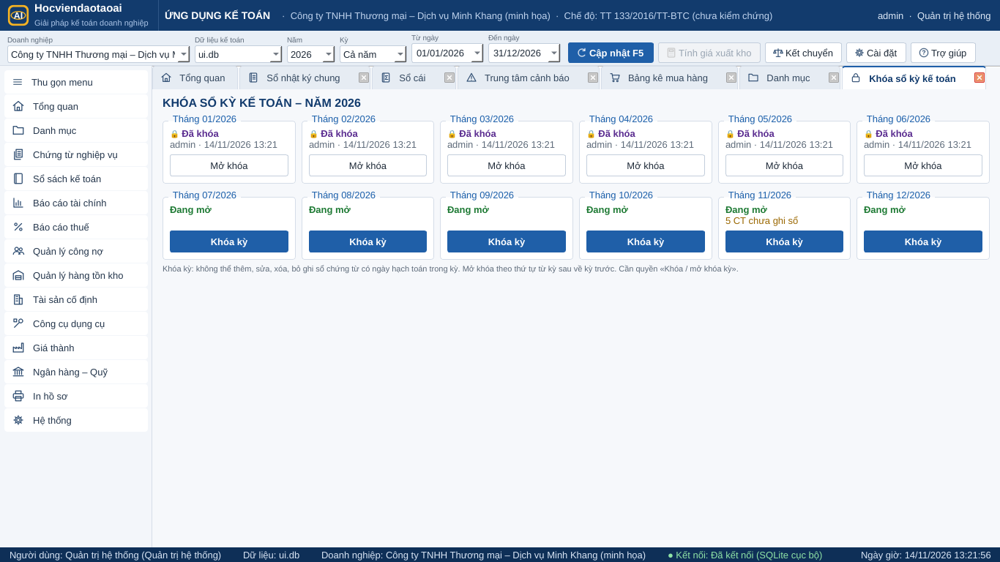
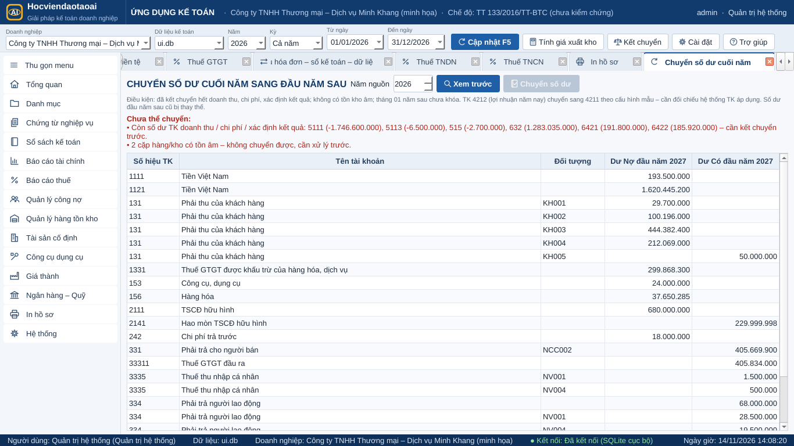

# Hướng dẫn dành cho Kế toán trưởng

**Bạn làm được:** mọi việc của Kế toán viên, cộng thêm **ghi sổ / bỏ ghi sổ**, **tính giá xuất kho**, chạy **khấu hao – phân bổ**, **giá thành**, **kết chuyển**, **khóa/mở khóa kỳ**, xem mọi báo cáo, báo cáo hỗ trợ thuế, in hồ sơ.
**Bạn không làm được (cần Quản trị):** người dùng & phân quyền, thông tin doanh nghiệp, chế độ kế toán, phương pháp tính giá xuất kho, mẫu báo cáo (nhập/xác nhận kiểm chứng), thuế suất TNDN, chuyển số dư cuối năm, sao lưu/khôi phục.

Đọc trước [phần chung](00_BAT_DAU_VA_NGUYEN_TAC_CHUNG.md). Kế toán viên nhập liệu theo [tài liệu của họ](01_KE_TOAN_VIEN.md).

---

## 1. Kiểm tra và ghi sổ chứng từ

### 1.1. Ghi sổ một chứng từ
Mở chứng từ → **Kiểm tra** (`F6`, nếu chưa) → **Ghi sổ** (`F9`).
- Ghi sổ **chỉ thành công** khi không còn *Lỗi chặn* và tổng Nợ = tổng Có. Nếu không, hộp thoại liệt kê lỗi cụ thể; dữ liệu không bị thay đổi.
- Sau khi ghi sổ, bút toán lên **nhật ký chung, sổ cái, sổ chi tiết, công nợ, kho, báo cáo**. Thuế GTGT trên bảng kê được sinh bút toán riêng (Nợ 1331 hoặc Có 33311).
- Chứng từ chưa kiểm tra vẫn ghi sổ được (ứng dụng kiểm tra lại ngay lúc ghi).

### 1.2. Ghi sổ hàng loạt
Danh sách chứng từ → lọc *Trạng thái = Nháp* hoặc *Đã kiểm tra* → chọn nhiều dòng (`Ctrl`/`Shift` + chuột) → **Ghi sổ các CT chọn**.
Chứng từ lỗi **bị bỏ qua** và được liệt kê kèm nguyên nhân để Kế toán viên sửa; các chứng từ hợp lệ vẫn được ghi sổ.

### 1.3. Bỏ ghi sổ
Mở chứng từ → **Bỏ ghi sổ** (`Ctrl+F9`) → chứng từ về **Đã kiểm tra**, số liệu rút khỏi sổ; sửa được bằng `F2`.
**Không bỏ ghi sổ được** khi tháng đã khóa – phải mở khóa kỳ trước (mục 8).

### 1.4. Hai người cùng thao tác (bản PostgreSQL)
Nếu hai người cùng ghi sổ một chứng từ, người đến sau nhận thông báo *"đã được ghi sổ"*, không có bút toán trùng. Nếu người khác sửa chứng từ khi bạn đang mở, ứng dụng báo *"đã được … sửa… hãy tải lại"* và không ghi đè.

---

## 2. Tính giá xuất kho

Nút **Tính giá xuất kho** trên thanh điều khiển (hoặc *Quản lý hàng tồn kho → Tính giá xuất kho*).

**Trước khi chạy**
- Các phiếu xuất/bảng kê của tháng phải **đã ghi sổ** (chứng từ nháp không tham gia).
- Kỳ tính phải **trọn tháng** (từ ngày 01 đến ngày cuối tháng; được chọn nhiều tháng liên tiếp trong một năm) và **chưa khóa**.
- **Phương pháp** do Quản trị cấu hình ở *Cài đặt → Doanh nghiệp & chế độ kế toán*: **Bình quân gia quyền cuối tháng** hoặc **FIFO**; dùng nhất quán cả năm.

**Các bước**
1. Chọn *Kỳ tính giá* → **Xem trước**.
2. Bảng trên: từng *mã hàng/kho* với *tồn đầu, nhập, xuất hiện ghi, xuất tính lại, chênh lệch, tồn cuối*. Bảng dưới trái: các **dòng xuất sẽ đổi** (đơn giá mới, thành tiền cũ → mới); bảng dưới phải: **cảnh báo** (tồn âm, chuyển kho nội bộ giữ nguyên…).
3. Dòng cuối: *"N dòng xuất sẽ được cập nhật · Tổng chênh lệch giá vốn: …"*.
4. **Cập nhật giá xuất kho** → xác nhận. Ứng dụng đổi đơn giá các dòng xuất, **ghi lại sổ** trong cùng một giao dịch.
5. Chạy lại cùng kỳ thì **không còn chênh lệch** (kết quả ổn định).

**Phạm vi:** chưa hỗ trợ chuyển kho nội bộ, bình quân tức thời, đích danh, hàng gửi bán; các dòng đó được **giữ nguyên** và cảnh báo trong bảng xem trước. Nếu một mặt hàng xuất vượt tồn, cảnh báo hiện ở bảng dưới – xử lý bằng cách bổ sung chứng từ nhập hoặc tồn đầu kỳ.

---

## 3. Tài sản cố định, CCDC, chi phí trả trước

### 3.1. Khấu hao TSCĐ hàng tháng
Menu **Tài sản cố định → tab Tính khấu hao tháng**.

1. Chọn *Năm*, *Tháng* → **Xem trước**: từng tài sản với *nguyên giá, đã khấu hao trước, số tháng này, còn lại sau tháng, TK Nợ/Có*.
2. Tích **Ghi sổ ngay** nếu muốn ghi sổ luôn (bỏ tích → tạo chứng từ **nháp** để rà soát).
3. **Chạy khấu hao tháng này** → ứng dụng tạo một chứng từ *Nghiệp vụ hạch toán* (Nợ TK chi phí / Có TK hao mòn) và mở ra.
4. Bảng **Lịch sử các lần chạy** liệt kê từng tháng đã chạy; **Hoàn tác lần chạy đã chọn** xóa chứng từ và bản ghi chạy (chỉ tháng **mới nhất**, kỳ chưa khóa).

**Quy ước (cần phù hợp chính sách của doanh nghiệp):** khấu hao **đường thẳng**; bắt đầu từ **tháng của ngày bắt đầu tính**; tháng cuối nhận **phần còn lại** để tổng đúng nguyên giá; chạy **tuần tự từng tháng** (tháng chưa có tài sản nào phát sinh được bỏ qua); mỗi tháng chạy **một lần**.
**Ghi giảm TSCĐ:** chọn tài sản ở tab *Danh sách* → **Ghi giảm TSCĐ…** nhập ngày: vẫn khấu hao tháng ghi giảm, ngừng từ tháng sau. Bút toán thanh lý hạch toán riêng bằng chứng từ nghiệp vụ.

### 3.2. Phân bổ CCDC và chi phí trả trước
Menu **Công cụ dụng cụ → tab Phân bổ hàng tháng**: cách dùng **giống hệt** khấu hao (Xem trước → Chạy → Lịch sử → Hoàn tác); hạch toán Nợ TK chi phí / Có TK nguồn (153, 242…).

---

## 4. Giá thành

Menu **Giá thành** có các ô: *Công trình xây dựng · Sản xuất theo định mức · Không định mức · Giản đơn · Dịch vụ · Vận tải · Không có dở dang* và *Sổ chi tiết công trình*. Tất cả dùng chung một bộ máy: **đối tượng tính giá thành = công trình/đơn hàng** trong danh mục; chi phí lấy từ **TK 154 đã ghi sổ**.

| Cách tính | Công thức / ý nghĩa |
|---|---|
| **Giản đơn** | Giá thành = Dở dang đầu kỳ + Chi phí phát sinh − Dở dang cuối kỳ |
| **Không có dở dang** | Dở dang cuối kỳ = 0 |
| **Theo định mức** | Như giản đơn + so sánh: giá thành định mức = SL × định mức đơn vị (bạn nhập); hiện *chênh lệch* và *% chênh lệch*. Ứng dụng không lập/duyệt định mức |
| **Không định mức** | Chi phí 154 **chưa gắn đối tượng** được phân bổ cho các đối tượng theo tỷ lệ chi phí trực tiếp |

**Các bước**
1. Chọn *Từ – đến* (thường một tháng), kiểm tra *Cách tính*, *TK Nợ kết chuyển* (155 thành phẩm, 632 giá vốn…) → **Tính từ sổ**.
2. Bảng hiện chi phí theo **khoản mục** của từng đối tượng. Nhập vào **ô vàng**: *Dở dang đầu kỳ* (đã tự lấy từ kỳ trước nếu có), *Dở dang cuối kỳ*, *SL hoàn thành*, (*Định mức đơn vị* nếu theo định mức). *Giá thành* và *Giá thành đơn vị* cập nhật ngay.
3. Hàng đầu cảnh báo nếu còn chi phí 154 chưa gắn đối tượng nằm ngoài giá thành.
4. **Lưu & tạo chứng từ kết chuyển giá thành (nháp)** → tạo chứng từ *Nợ TK giá vốn/thành phẩm / Có 154* cho từng đối tượng đủ điều kiện (giá thành > 0, SL > 0). **Kiểm tra và ghi sổ** chứng từ này như thường lệ.
5. **Hoàn tác kết chuyển kỳ này** xóa chứng từ (bảng tính đã nhập vẫn được giữ).
6. Nhấp đúp một đối tượng → **Sổ chi tiết công trình** (từng bút toán 154 + tổng hợp theo khoản mục).

### Chi phí sản xuất 621 / 622 / 627 → 154
Dành cho hệ thống TK **đã khai báo** TK 621, 622, 627 (hệ thống TK mẫu không có). Ở màn hình giá thành bấm **Kết chuyển CP 621/622/627 vào 154…**:
1. Chọn *Năm, Tháng*, nhập *TK trực tiếp* (mặc định `621,622`), *TK chung* (`627`), *Tiêu thức phân bổ* (tổng chi phí trực tiếp, hoặc chỉ nhân công trực tiếp).
2. **Xem trước**: từng đối tượng và số tiền kết chuyển; chi phí chung chưa gắn đối tượng được **phân bổ** theo tiêu thức; *Cảnh báo* cho chi phí trực tiếp chưa gắn đối tượng.
3. **Tạo chứng từ kết chuyển (nháp)** → kiểm tra, ghi sổ. Mỗi tháng chạy **một lần**; **Hoàn tác tháng này** khi cần.

Thứ tự gợi ý: ghi sổ chứng từ → **tính giá xuất kho** → **kết chuyển 621/622/627** → **tính giá thành** → ghi sổ chứng từ giá thành.

---

## 5. Kết chuyển cuối kỳ (xác định kết quả kinh doanh)

Nút **Kết chuyển** trên thanh điều khiển.

1. Chọn *Kỳ kết chuyển: từ – đến* (thường một tháng) → **Xem trước**: bút toán kết chuyển doanh thu, thu nhập (511, 515, 711), chi phí (632, 635, 642, 811, 821) sang 911 và kết quả sang 4212 (lãi/lỗ).
2. **Thực hiện kết chuyển** → xác nhận → ứng dụng tạo và **ghi sổ** chứng từ kết chuyển vào ngày cuối kỳ.
3. Bảng dưới liệt kê chứng từ kết chuyển đã có; chọn một dòng → **Hoàn tác chứng từ đã chọn** (bỏ ghi sổ + xóa) khi kỳ **chưa khóa**.
4. Không kết chuyển trùng: kỳ đã kết chuyển hết số dư thì xem trước trống.

> Ứng dụng **không tự tính chi phí thuế TNDN** khi kết chuyển. Nếu doanh nghiệp hạch toán thuế TNDN (TK 821), phải nhập bút toán đó **trước** khi kết chuyển.
> Thứ tự đúng: ghi sổ hết → khấu hao/phân bổ → tính giá xuất kho → giá thành → **kết chuyển** → khóa kỳ.

---

## 6. Báo cáo

### 6.1. Sổ sách và bảng cân đối số phát sinh
Xem như Kế toán viên (tài liệu 01, mục 7). Bảng cân đối số phát sinh có dòng **kiểm tra cân đối** ở chân trang (*Đầu kỳ / Phát sinh / Cuối kỳ: cân ✓*); nếu lệch hiển thị màu đỏ.

### 6.2. Báo cáo tài chính theo mẫu
Menu **Báo cáo tài chính**: *Báo cáo tình hình tài chính / Bảng cân đối kế toán · Kết quả hoạt động kinh doanh · Lưu chuyển tiền tệ · Thuyết minh*.

- Số liệu tính **từ sổ đã ghi sổ** theo **mẫu (chỉ tiêu + công thức)** đã nhập. Chọn mẫu ở ô trên cùng, chọn kỳ → **Xem**.
- Nhấp đúp một chỉ tiêu → xem **sổ chi tiết** của tài khoản cấu thành (nếu nhiều TK, chọn từ menu hiện ra) → chứng từ gốc.
- Dải màu trên bảng cho biết trạng thái mẫu: **cam = CHƯA KIỂM CHỨNG** (kèm cảnh báo trên cả bản in/PDF/Excel), **xanh lá = đã kiểm chứng** (kèm người xác nhận và căn cứ).
- **Quản lý mẫu…**: xem chỉ tiêu và công thức, trạng thái kiểm chứng. *Nhập mẫu* và *Xác nhận kiểm chứng* là việc của **Quản trị**, dựa trên văn bản chính thức do bạn cung cấp.
- Chưa có mẫu cho loại báo cáo → màn hình hướng dẫn nhập mẫu.

> **Quan trọng:** mẫu đi kèm (*DEMO_BS*, *DEMO_IS*) chỉ để thử kỹ thuật. **Không dùng để nộp hay công bố.** Hãy đối chiếu chế độ kế toán áp dụng, hệ thống tài khoản và mẫu báo cáo với văn bản chính thức rồi nhờ Quản trị nhập và xác nhận.

### 6.3. Báo cáo hỗ trợ thuế (không phải tờ khai điện tử)
Menu **Báo cáo thuế**. Mỗi màn hình có dải lưu ý: *hỗ trợ tính toán; không tự suy đoán thuế suất; người dùng chịu trách nhiệm đối chiếu quy định*.

| Màn hình | Nội dung |
|---|---|
| **Thuế GTGT** | 3 tab: *Hóa đơn mua vào*, *Hóa đơn bán ra* (theo ký hiệu, số, ngày, MST, thuế suất **do bạn chọn trên từng dòng**), *Tổng hợp & đối chiếu sổ* (thuế theo hóa đơn so với phát sinh TK 1331/33311; chênh lệch; đầu ra − đầu vào) |
| **Đối chiếu hóa đơn – sổ kế toán** | Chứng từ có thuế nhưng **tiền thuế khác bút toán trên sổ**, thiếu ký hiệu/số/ngày/MST, **trùng hóa đơn**, **lệch kỳ**, hạch toán thẳng vào TK thuế không qua hóa đơn |
| **Thuế TNDN** | Lợi nhuận kế toán trước thuế **từ sổ** + *điều chỉnh tăng/giảm* (bạn nhập kèm ghi chú căn cứ) = thu nhập tính thuế; **thuế suất do Quản trị nhập** kèm căn cứ – chưa nhập thì **không tính** |
| **Thuế TNCN** | Tổng hợp theo nhân viên: phải trả (Có TK 334), đã chi trả/khấu trừ (Nợ TK 334), thuế đã khấu trừ (Có TK 3335). **Chưa tính thuế theo biểu thuế** |

Tờ khai chính thức vẫn lập trên phần mềm/kênh kê khai của cơ quan thuế; dùng báo cáo này để **chuẩn bị và đối chiếu số liệu**.

### 6.4. Xuất và in
Mọi sổ, danh sách, báo cáo, chứng từ có nút **In** (xem trước), **Excel**, **PDF** ở góc phải. Excel giữ **kiểu số** (tính toán tiếp được). Bản in có chỗ ký *Người lập biểu – Kế toán trưởng – Giám đốc*.

### 6.5. In hồ sơ hàng loạt
Menu **In hồ sơ**: chọn *Từ – đến*, tích các mục (*Bảng cân đối số phát sinh, Sổ nhật ký chung, Sổ cái (mọi TK có phát sinh), Sổ quỹ, Sổ tiền gửi, Chứng từ đã ghi sổ*), chọn **Thư mục lưu** → **Xuất hồ sơ PDF**. Ứng dụng tạo các file PDF A4 và `00_MUC_LUC.txt`; việc in được ghi nhật ký.

---

## 7. Cảnh báo và đối chiếu trước khi khóa kỳ

Mở **Trung tâm cảnh báo** (`Ctrl+Shift+A`) với kỳ cần khóa. **Không nên khóa** khi còn *Lỗi chặn ghi sổ*. Đối chiếu bằng mắt thêm:
- **Bảng cân đối số phát sinh**: ba dòng kiểm tra đều *cân ✓*.
- **Công nợ**: tổng *còn phải thu/trả* theo hóa đơn = số dư trên sổ chi tiết 131/331.
- **Kho**: tổng giá trị tồn cuối (Nhập – xuất – tồn) = số dư TK kho; không có hàng tồn âm.
- **Đối chiếu doanh thu – giá vốn**: không còn dòng *Bán chưa xuất kho*.
- **Tồn quỹ tiền mặt** không âm.

---

## 8. Khóa và mở khóa kỳ

Menu **Hệ thống → Khóa sổ kỳ kế toán**.

- Mỗi tháng một ô: **Đang mở** (kèm số chứng từ chưa ghi sổ) hoặc **Đã khóa** (người khóa, thời điểm).
- **Khóa kỳ** → hộp thoại xác nhận, **cảnh báo nếu còn chứng từ chưa ghi sổ** (sau khóa sẽ không ghi sổ được).
- Tháng đã khóa: **không thêm, sửa, xóa, bỏ ghi sổ** chứng từ có ngày hạch toán trong tháng; không chạy khấu hao/tính giá cho tháng đó.
- **Mở khóa** phải làm **từ tháng sau về tháng trước** (muốn mở tháng 3 phải mở tháng 4 trước). Mọi khóa/mở khóa được ghi nhật ký.

---

## 9. Quy trình cuối tháng (danh sách việc)

| # | Việc | Ở đâu |
|---|---|---|
| 1 | Chốt Kế toán viên **nhập đủ chứng từ** của tháng | Danh sách chứng từ, lọc *Nháp* |
| 2 | Xử lý **lỗi chặn** và cảnh báo | Trung tâm cảnh báo |
| 3 | **Ghi sổ** toàn bộ chứng từ hợp lệ | Ghi sổ hàng loạt |
| 4 | **Xuất kho hàng loạt** cho bảng kê bán chưa có phiếu xuất; ghi sổ phiếu | Quản lý hàng tồn kho |
| 5 | **Tính giá xuất kho** (kỳ tháng) | Nút *Tính giá xuất kho* |
| 6 | **Khấu hao TSCĐ**, **phân bổ CCDC/chi phí trả trước** | Tài sản cố định; Công cụ dụng cụ |
| 7 | Kết chuyển **621/622/627 → 154** (nếu có) và **tính giá thành**, ghi sổ chứng từ giá thành | Giá thành |
| 8 | **Đối chiếu**: CĐSPS cân; công nợ; kho; doanh thu – giá vốn; quỹ | Mục 7 |
| 9 | Lập chứng từ thuế khác (nộp thuế…); xem **báo cáo thuế hỗ trợ** và **đối chiếu hóa đơn – sổ** | Báo cáo thuế |
| 10 | **Kết chuyển cuối kỳ** | Nút *Kết chuyển* |
| 11 | Xem **báo cáo tài chính**; **In hồ sơ** PDF lưu trữ | Báo cáo tài chính; In hồ sơ |
| 12 | **Khóa kỳ** | Hệ thống → Khóa sổ |
| 13 | Nhờ Quản trị **sao lưu** dữ liệu | Hệ thống → Sao lưu |

## 10. Quy trình cuối năm

1. Hoàn thành 12 tháng theo mục 9; **khóa** đủ 12 tháng.
2. Kiểm tra **không còn số dư** doanh thu/chi phí/xác định kết quả (đã kết chuyển hết); **không có tồn kho âm**.
3. Báo Quản trị **sao lưu** rồi thực hiện **Hệ thống → Chuyển số dư cuối năm** (chọn năm nguồn → *Xem trước* → xem tổng Nợ = Có → *Chuyển số dư*). Ứng dụng chuyển số dư tài khoản theo đối tượng và tồn kho sang đầu năm sau; **4212 → 4211** theo cấu hình mẫu (**cần đối chiếu hệ thống tài khoản áp dụng**). Số dư đầu năm sau cũ bị thay thế.
4. Chọn năm sau trên thanh điều khiển, kiểm tra **Bảng cân đối số phát sinh đầu năm** khớp báo cáo cuối năm trước.

---

## 11. Câu hỏi thường gặp

**Chạy "Tính giá xuất kho" báo kỳ không hợp lệ?** Phải từ ngày 01 đến ngày cuối tháng, trong một năm, và không có tháng nào đã khóa.

**Khấu hao báo "Chưa chạy tháng …"?** Phải chạy tuần tự; chạy tháng còn thiếu trước. Tháng chưa có tài sản nào phát sinh được bỏ qua tự động.

**Đã khóa kỳ nhưng phát hiện sai?** Mở khóa từ tháng sau về tháng trước đến tháng cần sửa → *Bỏ ghi sổ* chứng từ → sửa → ghi sổ lại → chạy lại các bước phụ thuộc (tính giá, kết chuyển) → khóa lại.

**Kết chuyển rồi mới phát hiện thiếu chứng từ?** *Hoàn tác* chứng từ kết chuyển (kỳ chưa khóa) → bổ sung chứng từ → ghi sổ → kết chuyển lại.

**Tồn kho bị âm?** Thường do thiếu phiếu nhập hoặc tồn đầu kỳ; mở *Thẻ kho* của mặt hàng để xem thời điểm âm đầu tiên rồi bổ sung chứng từ.

**Báo cáo tài chính hiện cảnh báo "CHƯA KIỂM CHỨNG"?** Mẫu chưa được xác nhận. Chỉ dùng nội bộ; nhờ Quản trị nhập mẫu theo văn bản chính thức và xác nhận kiểm chứng.

**Ai đã sửa/xóa/ghi sổ chứng từ này?** **Hệ thống → Nhật ký thay đổi**: lọc theo ngày và từ khóa (người dùng, thao tác, số chứng từ).
