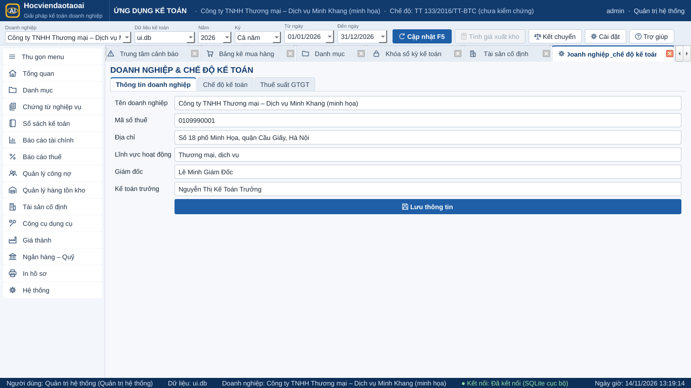
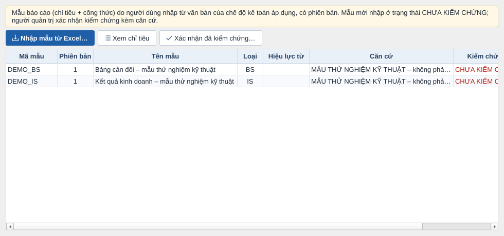

# Hướng dẫn dành cho Quản trị hệ thống

**Bạn có toàn quyền**, và là người duy nhất làm được: quản lý người dùng & phân quyền, thông tin doanh nghiệp, chế độ kế toán, phương pháp tính giá xuất kho, **nhập và xác nhận kiểm chứng mẫu báo cáo**, tham số thuế (thuế suất TNDN), chuyển số dư cuối năm, sao lưu/khôi phục, mở/tạo/chuyển dữ liệu.

Đọc trước [phần chung](00_BAT_DAU_VA_NGUYEN_TAC_CHUNG.md). Cài đặt máy chủ PostgreSQL: xem thêm [HUONG_DAN_CAI_DAT.md](../HUONG_DAN_CAI_DAT.md).

---

## 1. Thiết lập lần đầu (danh sách việc)

| # | Việc | Ở đâu |
|---|---|---|
| 1 | Cài ứng dụng; chọn **một người dùng (SQLite)** hay **nhiều người dùng (PostgreSQL)** | Mục 8 |
| 2 | **Tạo dữ liệu mới** (nhập tên doanh nghiệp) | Mục 2 |
| 3 | Đăng nhập `admin / admin@123` → **bị buộc đổi mật khẩu** | Mục 3 |
| 4 | Tạo **tài khoản cho từng người**, gán vai trò; **khóa hoặc đổi mật khẩu** các tài khoản mẫu | Mục 4 |
| 5 | Cập nhật **thông tin doanh nghiệp**, chọn **chế độ kế toán + ngày hiệu lực**, **phương pháp tính giá xuất kho** | Mục 5 |
| 6 | Nhập **hệ thống tài khoản** (Excel) đã đối chiếu văn bản; nhập danh mục đối tượng, vật tư… | Mục 6 |
| 7 | Nhập **mẫu báo cáo** đã kiểm chứng và xác nhận | Mục 7 |
| 8 | Thiết lập **sao lưu định kỳ** | Mục 9 |

## 2. Tạo dữ liệu mới, mở dữ liệu khác

Trên thanh điều khiển, ô **Dữ liệu kế toán** (chỉ Quản trị dùng được):
- **Mở dữ liệu khác…**: chọn file `.db` (SQLite). Ứng dụng kiểm tra đúng là dữ liệu của ứng dụng, **tự nâng cấp** lược đồ nếu là bản cũ, rồi bắt đăng nhập lại.
- **Tạo dữ liệu mới…**: nhập *Tên doanh nghiệp* và chọn nơi lưu. Dữ liệu mới có sẵn tài khoản mặc định – **đổi mật khẩu ngay**.
- **Kết nối PostgreSQL (nhiều người dùng)…**: xem mục 8.

> **Về nhiều doanh nghiệp:** ứng dụng lưu và chuyển đổi được nhiều doanh nghiệp trong cùng một dữ liệu (ô *Doanh nghiệp*), nhưng **chưa có màn hình thêm doanh nghiệp thứ hai**. Hiện cách làm: mỗi doanh nghiệp một file dữ liệu (SQLite) hoặc một CSDL PostgreSQL riêng.

## 3. Mật khẩu và đăng nhập
- Chính sách: ≥ 8 ký tự, có chữ và số, không trùng tên đăng nhập, không dùng mật khẩu mặc định.
- Sai 5 lần liên tiếp → khóa tạm 5 phút (tự mở). Mọi lần đăng nhập thành công/thất bại/bị từ chối đều có trong **Nhật ký thay đổi**.
- Người dùng tự đổi mật khẩu ở **Hệ thống → Đổi mật khẩu**. Mật khẩu được băm PBKDF2-SHA256 (600.000 vòng), không thể xem lại; quên thì **đặt lại** (mục 4).

## 4. Người dùng và phân quyền

Menu **Hệ thống → Người dùng & phân quyền**.

### 4.1. Người dùng
- **Thêm**: *Tên đăng nhập* (không đổi được sau này), *Họ tên*, *Vai trò*, *Mật khẩu* (đúng chính sách).
- **Sửa** (nhấp đúp): đổi họ tên, vai trò; bỏ chọn **Đang hoạt động** để **khóa** tài khoản; nhập *Mật khẩu* mới để **đặt lại** (để trống = không đổi). Đặt lại cũng xóa trạng thái khóa tạm.
- Không thể tự khóa tài khoản đang đăng nhập.

### 4.2. Ma trận phân quyền
Bảng dưới là các **vai trò × quyền**. Tích/bỏ tích rồi **Lưu phân quyền**; có hiệu lực **từ lần đăng nhập sau** của người dùng.

| Quyền | Cho phép |
|---|---|
| **Xem** | Xem mọi sổ, báo cáo, chứng từ |
| **Thêm / Sửa / Xóa** | Thêm, sửa, xóa danh mục và chứng từ (chưa ghi sổ, kỳ chưa khóa) |
| **Ghi sổ / Bỏ ghi sổ** | Ghi sổ, bỏ ghi sổ, tính giá xuất kho, kết chuyển, hoàn tác các thao tác chạy tháng |
| **Khóa / mở khóa kỳ** | Khóa sổ theo tháng |
| **Xuất dữ liệu** | Excel, PDF, in, in hồ sơ |
| **Quản trị hệ thống** | Mọi thao tác trong tài liệu này |

Vai trò mặc định: **Quản trị hệ thống** (đủ quyền, luôn giữ quyền quản trị), **Kế toán trưởng**, **Kế toán viên**, **Chỉ xem**. Nguyên tắc nên giữ: **tách người nhập và người ghi sổ**; chỉ 1–2 người có quyền quản trị.

## 5. Doanh nghiệp, chế độ kế toán, phương pháp tính giá

Menu **Hệ thống → Doanh nghiệp & chế độ kế toán** (hoặc nút **Cài đặt**).

### 5.1. Thông tin doanh nghiệp
Tab *Thông tin doanh nghiệp*: tên, mã số thuế, địa chỉ, lĩnh vực, giám đốc, kế toán trưởng → **Lưu thông tin**. Các thông tin này in trên bản in và dùng để **nhận diện hóa đơn XML mua vào/bán ra theo MST**.
Cùng tab: **Tính giá xuất kho** (*Bình quân gia quyền cuối kỳ (tháng)* hoặc *FIFO*) → **Áp dụng phương pháp**. Dùng nhất quán trong năm tài chính; sau khi đổi nên chạy lại *Tính giá xuất kho* cho các tháng chưa khóa.

### 5.2. Chế độ kế toán (có phiên bản theo ngày hiệu lực)
Tab *Chế độ kế toán*: danh sách chế độ (TT133/2016, TT200/2014, TT99/2025) và **lịch sử áp dụng** của doanh nghiệp.
1. **Đối chiếu văn bản chính thức** (hiệu lực, phạm vi áp dụng, đối tượng) **trước khi** chọn.
2. Chọn *Chế độ*, đặt *Hiệu lực từ* → **Áp dụng từ ngày**. Việc áp dụng **được lưu thành lịch sử**, không ghi đè kỳ trước.
3. Tất cả chế độ trong danh mục đang ghi **Chưa kiểm chứng**: ứng dụng **không mặc định áp dụng chế độ nào cho mọi doanh nghiệp**.

Tab *Thuế suất GTGT*: bảng thuế suất mẫu (**chưa kiểm chứng**, chỉ tham khảo). Ứng dụng **không tự áp thuế suất**: người nhập chứng từ chọn thuế suất trên từng dòng.

## 6. Hệ thống tài khoản và danh mục

Hệ thống tài khoản đi kèm (theo cấu hình mẫu TT133) chỉ để minh họa. Cho doanh nghiệp thật:
1. Lấy hệ thống tài khoản **theo chế độ đã chọn** từ văn bản đã kiểm chứng; lập file Excel với cột *Số hiệu TK, Tên tài khoản, TK cấp trên, Tính chất (Dư Nợ/Dư Có/Lưỡng tính), Hạch toán, Bắt buộc đối tượng, Đang dùng*.
2. **Danh mục → Hệ thống tài khoản → Nhập Excel** → ánh xạ cột → *Kiểm tra* → *Nhập dữ liệu* (xem tài liệu Kế toán viên, mục 1.2). Ứng dụng nạp TK cha trước TK con.
3. Đánh dấu **Bắt buộc đối tượng** cho các TK công nợ (131, 331, 141…).
4. Tài khoản đã phát sinh số liệu **không đổi được số hiệu** và không xóa được (chỉ bỏ chọn *Đang dùng*).
5. Các tài khoản dùng cho kết chuyển (cấu hình mẫu): doanh thu/thu nhập 511, 515, 711; chi phí 632, 635, 642, 811, 821; kết quả 911; lợi nhuận 4212; năm trước 4211. Nếu hệ thống tài khoản của doanh nghiệp khác, **báo để chỉnh cấu hình**.
6. Muốn dùng **kết chuyển 621/622/627 vào 154** cần có các TK này trong hệ thống tài khoản.

## 7. Mẫu báo cáo tài chính (nhập và kiểm chứng)

Ứng dụng **không tự đặt chỉ tiêu hay công thức báo cáo**. Mẫu do bạn nhập từ **văn bản đã kiểm chứng**; mỗi mẫu có **phiên bản**.

### 7.1. Chuẩn bị file Excel
Sheet đầu tiên, mỗi dòng một chỉ tiêu:

| Cột | Nội dung |
|---|---|
| A | **Mã chỉ tiêu** (duy nhất, không dấu cách) |
| B | **Tên chỉ tiêu** |
| C | **Công thức** (để trống = dòng tiêu đề/diễn giải) |
| D | Thụt lề (0, 1, 2…) |
| E | In đậm (`1` hoặc `x`) |

### 7.2. Cú pháp công thức
Ví dụ: `DN(111,112)+DN(131)-[A5]`. Số hạng gồm: số, **`[mã chỉ tiêu khác]`**, hàm, ngoặc đơn, dấu âm; phép `+ - * /`. Đối số của hàm là các **số hiệu TK** (gồm cả TK con).

| Hàm | Ý nghĩa |
|---|---|
| `DN(…)` / `CN(…)` | Dư **Nợ** / dư **Có** cuối kỳ |
| `DNDK(…)` / `CNDK(…)` | Dư Nợ / dư Có **đầu năm** (cột *Đầu năm* của báo cáo loại BS) |
| `PSN(…)` / `PSC(…)` | Phát sinh **Nợ** / **Có** trong kỳ |
| `PSNDU(TK;TKĐƯ)` / `PSCDU(TK;TKĐƯ)` | Phát sinh Nợ / Có của TK **đối ứng** với TKĐƯ, ví dụ `PSNDU(511;911)` – dùng cho báo cáo lưu chuyển tiền tệ, kết quả kinh doanh |

Công thức chỉ đọc **sổ đã ghi sổ**. Loại mẫu: **BS** (tình hình tài chính/cân đối – có cột Đầu năm), **IS** (kết quả kinh doanh), **CF** (lưu chuyển tiền tệ), **TM** (thuyết minh – dòng chữ + dòng số liệu).

### 7.3. Nhập mẫu
1. Mở bất kỳ báo cáo tài chính → **Quản lý mẫu… → Nhập mẫu từ Excel…**.
2. Chọn file; điền *Mã mẫu, Tên mẫu, Loại, Mã chế độ kế toán, Hiệu lực từ* và **Căn cứ văn bản** (bắt buộc: số hiệu văn bản, phụ lục, mẫu số…); *Số dòng tiêu đề bỏ qua* (thường 1).
3. **Kiểm tra và nhập**. Ứng dụng báo lỗi **theo dòng** (mã lặp, công thức sai cú pháp, hàm lạ, tham chiếu chỉ tiêu không tồn tại, **công thức vòng tròn**). **Còn lỗi thì không nhập gì.**
4. Nhập lại cùng *Mã mẫu* sẽ tạo **phiên bản mới** (v2, v3…), không ghi đè bản cũ.
5. Mẫu mới nhập ở trạng thái **CHƯA KIỂM CHỨNG**.

### 7.4. Xác nhận kiểm chứng
1. **Xem chỉ tiêu** (nhấp đúp dòng) và đối chiếu từng chỉ tiêu, công thức với văn bản; chạy thử báo cáo trên kỳ thực, kiểm tra các dòng tổng/dòng kiểm tra.
2. Chọn mẫu → **Xác nhận đã kiểm chứng…** → ghi *Căn cứ đã đối chiếu* (số hiệu văn bản, điều/phụ lục, ngày hiệu lực, nguồn chính thức; tối thiểu 10 ký tự).
3. Báo cáo từ mẫu đã kiểm chứng hiện **dải xanh** kèm người xác nhận; cảnh báo trên bản in/PDF/Excel mất đi. Việc này được ghi nhật ký.

> Mẫu thử nghiệm đi kèm (*DEMO_BS*, *DEMO_IS*) **không bao giờ** được dùng để nộp. Nếu chưa lấy được văn bản chính thức, hãy để báo cáo ở trạng thái *chưa kiểm chứng*.

## 8. PostgreSQL (nhiều người dùng)

Chi tiết dựng máy chủ, tài khoản, TLS, `pg_hba.conf`: xem [HUONG_DAN_CAI_DAT.md](../HUONG_DAN_CAI_DAT.md). Tóm tắt thao tác trong ứng dụng:

| Việc | Cách làm |
|---|---|
| **Khởi tạo CSDL** (một lần) | `UngDungKeToan.exe --db postgresql://người_dùng@máy-chủ:5432/tên_csdl --init --company "Tên doanh nghiệp"` (thêm `--demo` để nạp dữ liệu minh họa). **Không ghi đè** CSDL đã có dữ liệu |
| **Kết nối từng máy** | *Dữ liệu kế toán → Kết nối PostgreSQL…* → máy chủ, cổng, tên CSDL, người dùng (mật khẩu có thể bỏ trống nếu dùng `~/.pgpass`/`PGPASSWORD`) → *Kiểm tra kết nối* → *Kết nối*. Mật khẩu CSDL **không được lưu** |
| **Chuyển dữ liệu SQLite → PostgreSQL** | Tạo CSDL PostgreSQL **trống**; trong ứng dụng đang mở file SQLite: **Hệ thống → Sao lưu – khôi phục → Chuyển dữ liệu sang PostgreSQL…**; hoặc dòng lệnh `UngDungKeToan.exe --db "file.db" --to-postgres postgresql://…`. Chuyển trong **một giao dịch**, đối chiếu số dòng và tổng Nợ/Có; lỗi thì đích vẫn trống; **không sửa file nguồn** |
| **Nhiều người cùng làm** | Ghi sổ/xóa có khóa dòng; số chứng từ tuần tự không trùng; sửa chồng bị chặn; khóa kỳ có hiệu lực ngay |

Khuyến nghị: chỉ mở cổng PostgreSQL trong mạng nội bộ/VPN, bật TLS (`?sslmode=require`), tài khoản CSDL dùng riêng cho ứng dụng, **không đặt file SQLite trong thư mục chia sẻ mạng**.

## 9. Sao lưu và khôi phục

Menu **Hệ thống → Sao lưu – khôi phục**.

| Nút | Việc làm |
|---|---|
| **Sao lưu ngay** | Tạo bản sao trong thư mục sao lưu của ứng dụng (`ketoan_YYYYMMDD_HHMMSS.db`; PostgreSQL: `.dump`) |
| **Sao lưu ra file…** | Chọn nơi lưu (ổ ngoài, thư mục mạng…) |
| **Khôi phục từ bản đã chọn / từ file…** | Ứng dụng **tự sao lưu dữ liệu hiện tại** (`truoc_khoi_phuc_…`) rồi ghi đè; sau đó **đóng mọi tab** và nạp lại. Bản sao lưu từ phiên bản cũ được tự nâng cấp |

- **SQLite:** dùng bộ sao lưu của SQLite (nhất quán kể cả khi đang mở).
- **PostgreSQL:** cần `pg_dump`/`pg_restore` (PostgreSQL client tools) trong `PATH` của máy chạy ứng dụng; khôi phục khi **không ai đang làm việc**. Ngoài ra nên có **sao lưu định kỳ ở phía máy chủ** (pg_dump theo lịch, lưu bản sao ngoài máy chủ).
- **Kiểm tra khả năng khôi phục** định kỳ: khôi phục thử một bản sao lưu vào máy khác.
- Lịch gợi ý: **hằng ngày** (tự động phía máy chủ), **trước khi khóa kỳ/chuyển số dư cuối năm/nâng cấp phiên bản/khôi phục** (thủ công), lưu **nhiều thế hệ** (ngày, tuần, tháng).

## 10. Nhật ký thay đổi

Menu **Hệ thống → Nhật ký thay đổi**: lọc theo ngày và từ khóa (người dùng, thao tác, số chứng từ, nội dung).
Ghi lại: đăng nhập (thành công, thất bại, bị khóa), thêm/sửa/xóa danh mục và chứng từ, ghi sổ/bỏ ghi sổ, kết chuyển, khóa/mở khóa kỳ, chạy khấu hao/tính giá, xuất dữ liệu, sao lưu/khôi phục, thay đổi người dùng/phân quyền/chế độ kế toán/mẫu báo cáo/tham số thuế. Người dùng thường **không xóa/sửa được** nhật ký.

## 11. Tham số thuế

**Thuế suất TNDN:** *Báo cáo thuế → Thuế TNDN* → ô *Thuế suất TNDN (%)* và *Căn cứ* (bắt buộc) → **Lưu thuế suất**. Chưa nhập thì báo cáo **không tính** thuế. Giá trị theo từng năm; nhập theo văn bản hiện hành.

## 12. Nâng cấp phiên bản ứng dụng
1. **Sao lưu** dữ liệu.
2. Cài phiên bản mới (ghi đè thư mục chương trình; dữ liệu nằm ở `%APPDATA%\Hocviendaotaoai\KeToan` hoặc ở PostgreSQL nên không mất).
3. Mở ứng dụng: dữ liệu cũ **tự nâng cấp lược đồ** trong một giao dịch. Với PostgreSQL nhiều máy: nâng cấp **tất cả máy** (máy bản cũ sẽ không mở được dữ liệu đã nâng cấp).
4. Chạy lại kiểm tra: bảng cân đối số phát sinh cân; vài báo cáo trùng trước nâng cấp.

## 13. Danh sách kiểm tra bảo mật
- [ ] Đã đổi mật khẩu mọi tài khoản mặc định (hoặc khóa chúng).
- [ ] Mỗi người một tài khoản riêng; vai trò đúng nhiệm vụ; chỉ 1–2 quản trị.
- [ ] Người nghỉ việc/đổi vị trí: khóa hoặc đổi vai trò ngay.
- [ ] PostgreSQL: chỉ mạng nội bộ/VPN, TLS bật, `pg_hba.conf` giới hạn địa chỉ, mật khẩu mạnh.
- [ ] Sao lưu tự động, lưu nhiều thế hệ, **đã thử khôi phục**.
- [ ] Máy trạm cài bản chương trình từ nguồn tin cậy (ưu tiên bản có **chữ ký số**).
- [ ] Rà **Nhật ký thay đổi** định kỳ (đăng nhập thất bại lặp lại, xóa/bỏ ghi sổ bất thường).

## 14. Sự cố thường gặp

| Hiện tượng | Nguyên nhân / cách xử lý |
|---|---|
| *Tài khoản tạm khóa đến hh:mm* | Nhập sai 5 lần. Chờ hết hạn hoặc **đặt lại mật khẩu** (mục 4.1) |
| *File … không phải dữ liệu của Ứng dụng Kế toán* | Chọn đúng file `.db` do ứng dụng tạo/sao lưu |
| *Dữ liệu được tạo bởi phiên bản mới hơn…* | Cập nhật ứng dụng lên phiên bản mới nhất |
| *Không kết nối được PostgreSQL* | Kiểm tra máy chủ/cổng/tường lửa, tên CSDL, người dùng, mật khẩu; thử *Kiểm tra kết nối* |
| *Không tìm thấy pg_dump/pg_restore* | Cài PostgreSQL client tools và thêm vào `PATH` |
| *Mẫu có lỗi, chưa nhập: …* | Sửa theo danh sách lỗi theo dòng (mục 7.3) |
| Người dùng bị từ chối *thiếu quyền …* | Kiểm tra ma trận phân quyền (mục 4.2); người dùng cần đăng nhập lại sau khi đổi quyền |
| Báo *Lỗi hệ thống* | Dữ liệu thao tác đó đã hoàn tác. Ghi lại nội dung và giờ, đối chiếu **Nhật ký thay đổi**, liên hệ nhà cung cấp |
| Sao lưu PostgreSQL lỗi `transaction_timeout` khi khôi phục | Do công cụ client mới hơn máy chủ; ứng dụng bỏ qua lỗi vô hại này. Nếu còn lỗi khác, dùng cùng phiên bản client và máy chủ |
