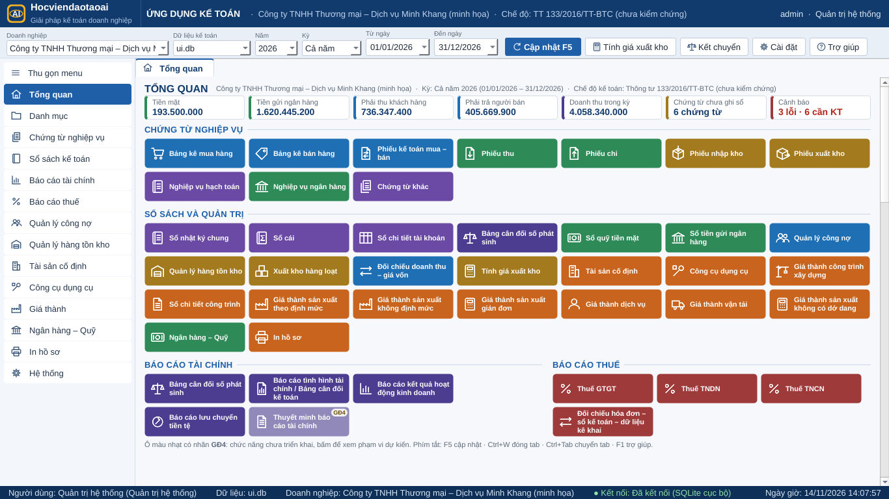

# Hướng dẫn dành cho Người xem / Lãnh đạo

Vai trò **Chỉ xem** có quyền **xem** mọi sổ sách, báo cáo và chứng từ. Không thêm, sửa, xóa, ghi sổ; **không xuất Excel/PDF/in** (nếu cần, nhờ Quản trị cấp thêm quyền *Xuất dữ liệu*). Đọc trước [phần chung](00_BAT_DAU_VA_NGUYEN_TAC_CHUNG.md).

## 1. Xem nhanh tình hình ở màn hình Tổng quan

| Chỉ số | Ý nghĩa | Bấm vào để |
|---|---|---|
| Tiền mặt, Tiền gửi ngân hàng | Số dư cuối kỳ TK tiền (đã ghi sổ) | Mở sổ quỹ / sổ ngân hàng |
| Phải thu khách hàng / Phải trả người bán | Dư công nợ cuối kỳ | Mở tổng hợp công nợ |
| Doanh thu trong kỳ | Phát sinh doanh thu trong kỳ đang chọn | Mở báo cáo liên quan |
| Chứng từ chưa ghi sổ | Số chứng từ Nháp/Đã kiểm tra | Mở danh sách chứng từ |
| Cảnh báo | Số vấn đề cần xử lý | Mở Trung tâm cảnh báo |

Chọn **Năm** và **Kỳ** (tháng/quý/cả năm/tùy chọn) trên thanh điều khiển rồi bấm **Cập nhật F5**.

> Số liệu chỉ gồm chứng từ **đã ghi sổ**. Nếu "Chứng từ chưa ghi sổ" khác 0, số liệu còn có thể thay đổi.

## 2. Các sổ và báo cáo nên xem

| Nhu cầu | Vào đâu |
|---|---|
| Biến động tài khoản | *Sổ sách kế toán → Bảng cân đối số phát sinh*, *Sổ cái*, *Sổ nhật ký chung* |
| Tiền | *Ngân hàng – Quỹ* (sổ quỹ, sổ tiền gửi) |
| Ai nợ mình, mình nợ ai | *Quản lý công nợ* (tổng hợp, chi tiết, tuổi nợ, đến hạn/quá hạn) |
| Hàng hóa | *Quản lý hàng tồn kho* (nhập – xuất – tồn, thẻ kho) |
| Tài sản, công cụ | *Tài sản cố định*, *Công cụ dụng cụ* |
| Giá thành | *Giá thành* |
| Báo cáo tài chính | *Báo cáo tài chính* |
| Thuế (hỗ trợ tính) | *Báo cáo thuế* |

## 3. Truy ngược về chứng từ gốc
Trong mọi sổ/báo cáo, **nhấp đúp** (hoặc `Enter`) vào dòng số liệu để mở chứng từ gốc (chỉ xem). Từ chứng từ thấy được người lập, ngày, các dòng hạch toán và trạng thái.

## 4. Đọc báo cáo tài chính đúng cách
- Dải **vàng "CHƯA KIỂM CHỨNG"**: mẫu báo cáo chưa được Quản trị đối chiếu với văn bản chính thức → **chỉ để tham khảo nội bộ, không dùng nộp cơ quan nhà nước**.
- Dải **xanh**: mẫu đã được xác nhận kiểm chứng (kèm người xác nhận và căn cứ).
- Báo cáo thuế là **hỗ trợ tính toán**, không phải tờ khai điện tử.
- Báo cáo luôn cho cùng số liệu nếu cùng kỳ và cùng trạng thái ghi sổ; kỳ **đã khóa** thì số liệu không đổi nữa.

## 5. Trung tâm cảnh báo (`Ctrl+Shift+A`)
Liệt kê vấn đề như chứng từ chưa ghi sổ, công nợ quá hạn, tồn kho âm, chênh lệch giữa sổ và chi tiết. Người xem chỉ đọc; chuyển nội dung cho Kế toán viên/Kế toán trưởng xử lý.

## 6. Giới hạn của vai trò
| Thao tác | Kết quả |
|---|---|
| Thêm/sửa/xóa chứng từ, danh mục | Bị từ chối, nêu rõ thiếu quyền |
| Ghi sổ, khóa kỳ | Bị từ chối |
| Xuất Excel, PDF, in | Bị từ chối nếu chưa được cấp quyền *Xuất dữ liệu* |

## 7. Hỏi đáp
- **Số khác với hôm qua?** Có chứng từ mới ghi sổ/bỏ ghi sổ, hoặc kỳ vừa được tính giá xuất kho. Xem *Nhật ký thay đổi* (nhờ Quản trị).
- **Không thấy chứng từ vừa nhập?** Chứng từ chưa ghi sổ không lên sổ/báo cáo.
- **Quên mật khẩu / bị khóa?** Chờ 5 phút hoặc nhờ Quản trị đặt lại.
